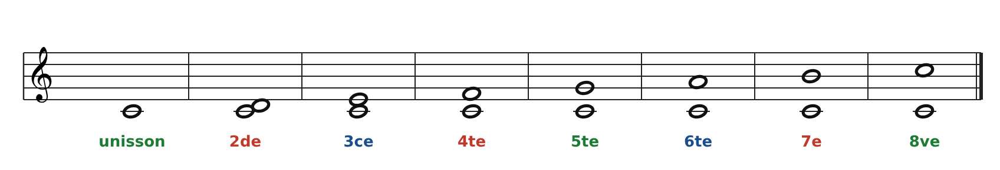

[← 1. Qu'est-ce que le contrepoint ?](01-qu-est-ce-que-le-contrepoint.md) · [Sommaire](../README.md#sommaire) · [3. Les quatre mouvements entre deux voix →](03-les-quatre-mouvements-entre-deux-voix.md)

## 2. Les outils : intervalles et consonances

Tout le contrepoint repose sur une question : **quel intervalle entend-on entre les deux voix ?** On compte les notes en incluant les deux extrémités (de Do à Mi : Do-Ré-Mi = une tierce).

On classe les intervalles en trois familles (code couleur utilisé dans tout le cours) :

| Famille                            | Intervalles                                               | Effet sonore            | Usage                                   |
|------------------------------------|-----------------------------------------------------------|-------------------------|-----------------------------------------|
| Consonances **parfaites** (vert)   | unisson, 5te juste, 8ve                                   | Très stable, « vide »   | Début et fin ; avec précaution ailleurs |
| Consonances **imparfaites** (bleu) | 3ce, 6te (majeures ou mineures)                           | Stable et riche         | Le cœur du contrepoint                  |
| **Dissonances** (rouge)            | 2de, 4te, 7e, 5te diminuée (Si-Fa), 4te augmentée (Fa-Si) | Tendu, demande à bouger | Interdites en 1re espèce                |

**Attention à la quarte** : entre deux voix, elle est considérée comme une dissonance en contrepoint strict.

**Intervalles redoublés** : au-delà de l'octave, on enlève 7 pour retrouver l'intervalle simple. Une 10e se comporte comme une 3ce, une 12e comme une 5te.

---

[← 1. Qu'est-ce que le contrepoint ?](01-qu-est-ce-que-le-contrepoint.md) · [Sommaire](../README.md#sommaire) · [3. Les quatre mouvements entre deux voix →](03-les-quatre-mouvements-entre-deux-voix.md)
