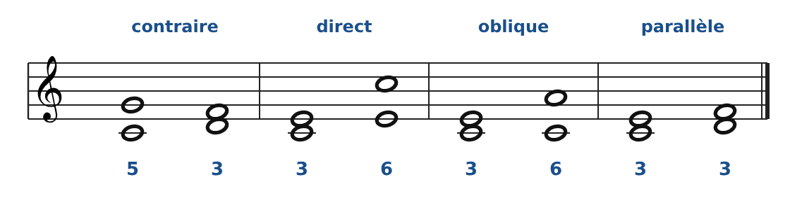
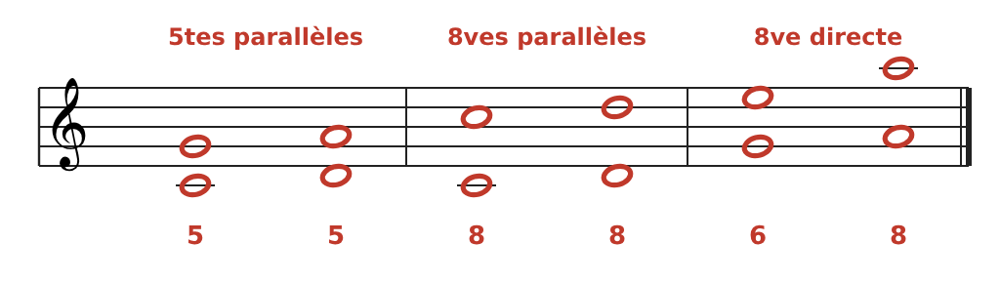

[← 2. Les outils : intervalles et consonances](02-les-outils-intervalles-et-consonances.md) · [Sommaire](../README.md#sommaire) · [4. Le cantus firmus →](04-le-cantus-firmus.md)

## 3. Les quatre mouvements entre deux voix

Quand on passe d'un intervalle au suivant, les deux voix bougent l'une par rapport à l'autre de quatre façons possibles. C'est le **mouvement contraire** qui rend les voix le plus indépendantes.

| Mouvement     | Ce qui se passe                                       | Exemple ci-dessus          |
|---------------|-------------------------------------------------------|----------------------------|
| **Contraire** | Une voix monte, l'autre descend                       | Do-Sol → Ré-Fa (5te → 3ce) |
| **Direct**    | Les deux montent (ou descendent), l'intervalle change | Do-Mi → Mi-Do (3ce → 6te)  |
| **Oblique**   | Une voix reste sur place, l'autre bouge               | Do-Mi → Do-La (3ce → 6te)  |
| **Parallèle** | Les deux bougent dans le même sens, même intervalle   | Do-Mi → Ré-Fa (3ce → 3ce)  |

### Les trois fautes à connaître par cœur

1.  **Quintes parallèles** : deux 5tes de suite. Les voix fusionnent et perdent leur indépendance.

2.  **Octaves parallèles** : deux 8ves de suite (ou deux unissons). Les deux voix n'en font plus qu'une.

3.  **Quinte ou octave directe** (dite « cachée ») : arriver sur une 5te ou une 8ve par mouvement direct. Le résultat sonne presque comme des parallèles.

**Règle d'or** : on arrive sur une consonance parfaite (5te, 8ve) **par mouvement contraire ou oblique**, jamais par mouvement direct ou parallèle. Les 3ces et 6tes parallèles, elles, sont autorisées (pas plus de trois de suite).

---

[← 2. Les outils : intervalles et consonances](02-les-outils-intervalles-et-consonances.md) · [Sommaire](../README.md#sommaire) · [4. Le cantus firmus →](04-le-cantus-firmus.md)
