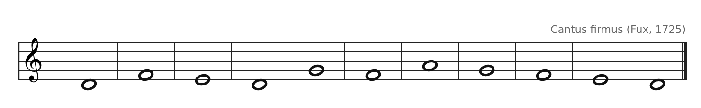

[← 3. Les quatre mouvements entre deux voix](03-les-quatre-mouvements-entre-deux-voix.md) · [Sommaire](../README.md#sommaire) · [5. Première espèce : note contre note →](05-premiere-espece-note-contre-note.md)

## 4. Le cantus firmus

Le cantus firmus (CF) est une mélodie simple en rondes, sur laquelle on construit le contrepoint. Voici le premier cantus firmus de Fux, en mode de Ré :

Un bon cantus firmus (et plus tard, un bon contrepoint) respecte ces principes :

- **8 à 16 notes**, toutes de même durée (rondes).

- **Commence et finit sur la tonique** (ici Ré ; Do dans nos exemples en Do majeur).

- **Surtout des mouvements conjoints** (par degrés), avec quelques petits sauts (3ce, 4te, 5te).

- **Après un grand saut, on repart dans l'autre sens**, par degré conjoint de préférence.

- **Sauts interdits** : 7e, saut de plus d'une 8ve, triton (Fa-Si), 6te majeure.

- **Un seul point culminant** (la note la plus aiguë n'apparaît qu'une fois).

- **Fin par degré conjoint** : la note avant la dernière est en général Ré (en Do majeur), qui descend sur Do.

---

[← 3. Les quatre mouvements entre deux voix](03-les-quatre-mouvements-entre-deux-voix.md) · [Sommaire](../README.md#sommaire) · [5. Première espèce : note contre note →](05-premiere-espece-note-contre-note.md)
