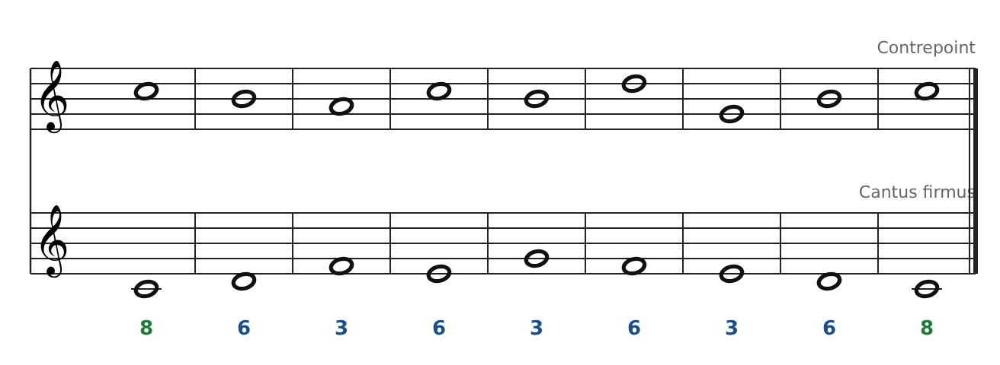
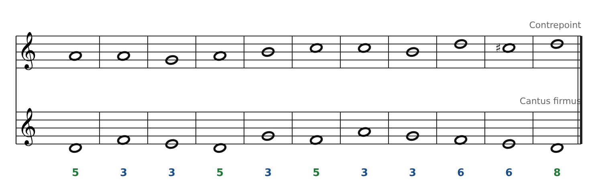

[← 4. Le cantus firmus](04-le-cantus-firmus.md) · [Sommaire](../README.md#sommaire) · [6. Deuxième espèce : deux notes contre une →](06-deuxieme-espece-deux-notes-contre-une.md)

## 5. Première espèce : note contre note

On écrit **une ronde contre chaque ronde** du cantus firmus. C'est l'espèce la plus stricte : tout doit être consonant.

### Les règles

1.  **Uniquement des consonances** : 3ce, 5te, 6te, 8ve (unisson seulement au début ou à la fin).

2.  **Début** sur une consonance parfaite (8ve ou 5te, la 5te seulement si le contrepoint est au-dessus).

3.  **Fin** sur l'octave (ou l'unisson), atteinte par mouvement contraire.

4.  **Avant-dernière mesure** : 6te majeure au-dessus du cantus (Ré sous Si) qui s'ouvre sur l'octave Do-Do.

5.  **Jamais de 5tes ou 8ves parallèles ou directes** (voir partie 3).

6.  **Privilégier les consonances imparfaites** (3ces, 6tes) au milieu, et le **mouvement contraire**.

7.  **Pas plus de trois 3ces ou 6tes parallèles** de suite.

8.  **Pas de note répétée** dans le contrepoint, pas de croisement des voix, écart maximum d'une 10e.

9.  Le contrepoint doit être **une belle mélodie** (mêmes principes que le cantus firmus).

**Et la sensible ?** Elle doit monter sur la tonique **seulement à la cadence finale** (c'est ce que garantit la règle 4). Au milieu de la ligne, c'est un degré comme un autre : elle peut descendre par degré ou sauter d'une tierce. En mineur et dans les modes, on ne la hausse (Sol♯, Do♯) qu'à l'avant-dernière mesure.

### Exemple 1 : en Do majeur

Les chiffres sous la portée donnent l'intervalle entre les deux voix : **8 - 6 - 3 - 6 - 3 - 6 - 3 - 6 - 8**. On part et on finit sur l'octave ; au milieu, que des 3ces et des 6tes. Presque tous les enchainements sont en mouvement contraire. Le point culminant (Ré, mesure 6) n'apparaît qu'une fois, et le grand saut Ré-Sol est suivi d'un retour vers le haut.

### Exemple 2 : la solution de Fux (mode de Ré)

Intervalles : 5 - 3 - 3 - 5 - 3 - 5 - 3 - 3 - 6 - 6 - 8. Remarque le **Do♯** à l'avant-dernière mesure : dans les modes sans sensible, on hausse la note qui monte vers la finale pour créer une vraie cadence (Do♯-Ré au-dessus de Mi-Ré). Les 5tes des mesures 4 et 6 sont toutes atteintes par mouvement contraire.

### Méthode pas à pas

1.  Écris d'abord **la fin** : dernière note (8ve) et avant-dernière (6te).

2.  Écris **le début** (8ve ou 5te).

3.  Remplis le milieu **de gauche à droite** : pour chaque note du CF, liste les notes consonantes possibles au-dessus, puis choisis celle qui donne un mouvement contraire et une ligne mélodique souple.

4.  **Vérifie** chaque enchainement : pas de 5tes/8ves parallèles ou directes ?

5.  **Chante ou joue** le résultat. Si une voix sonne maladroite, retravaille-la.

---

[← 4. Le cantus firmus](04-le-cantus-firmus.md) · [Sommaire](../README.md#sommaire) · [6. Deuxième espèce : deux notes contre une →](06-deuxieme-espece-deux-notes-contre-une.md)
