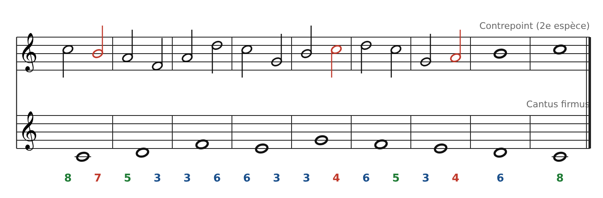

[← 5. Première espèce : note contre note](05-premiere-espece-note-contre-note.md) · [Sommaire](../README.md#sommaire) · [6 bis. Troisième espèce : quatre notes contre une →](07-troisieme-espece-quatre-notes-contre-une.md)

## 6. Deuxième espèce : deux notes contre une

Le contrepoint avance maintenant en **blanches** : deux notes pour chaque ronde du cantus. La grande nouveauté : on peut utiliser une **dissonance**, à condition qu'elle soit une **note de passage**.

### Les règles

1.  **Temps fort** (1re blanche) : toujours **consonant**, avec les mêmes règles qu'en 1re espèce.

2.  **Temps faible** (2e blanche) : consonant, **ou** dissonant s'il s'agit d'une note de passage.

3.  **Note de passage** : une note qui relie deux notes séparées d'une 3ce, **par degrés conjoints et dans la même direction** (ex. Do-Si-La). Elle n'est jamais atteinte ni quittée par saut.

4.  **Pas de 5tes ou 8ves sur deux temps forts consécutifs** : la blanche du milieu ne « cache » pas la faute.

5.  **Pas de 5te ou 8ve atteinte par mouvement direct** du temps faible au temps fort suivant.

6.  **Pas de note répétée.** L'avant-dernière mesure peut être une ronde (6te), la dernière est une ronde (8ve).

### Exemple

Les notes en **rouge** sont des notes de passage dissonantes :

- **Mesure 1** : Do-**Si**-La. Le Si fait une 7e avec le Do du cantus, mais il relie Do et La par degrés.

- **Mesure 5** : Si-**Do**-Ré. Le Do fait une 4te avec le Sol du cantus.

- **Mesure 7** : Sol-**La**-Si. Le La fait une 4te avec le Mi du cantus.

Tous les temps forts sont consonants : 8 - 5 - 3 - 6 - 3 - 6 - 3 - 6 - 8. Les sauts (La-Fa, La-Ré, Do-Sol) touchent toujours deux consonances.

### Pour aller plus loin : les espèces suivantes

Les **3e et 4e espèces** sont détaillées juste après (parties 6 bis et 6 ter), avec exemple, exercice et corrigé. La **5e espèce** (contrepoint fleuri) mélange librement toutes les espèces : c'est déjà de la vraie musique.

---

[← 5. Première espèce : note contre note](05-premiere-espece-note-contre-note.md) · [Sommaire](../README.md#sommaire) · [6 bis. Troisième espèce : quatre notes contre une →](07-troisieme-espece-quatre-notes-contre-une.md)
