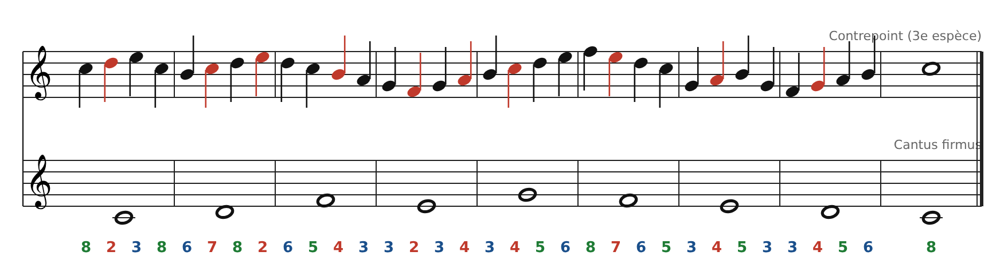
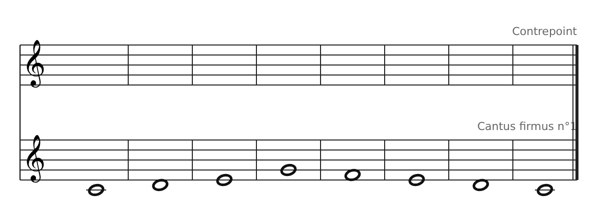
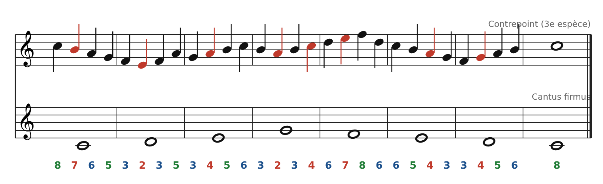

[← 6. Deuxième espèce : deux notes contre une](06-deuxieme-espece-deux-notes-contre-une.md) · [Sommaire](../README.md#sommaire) · [6 ter. Quatrième espèce : les syncopes →](08-quatrieme-espece-les-syncopes.md)

## 6 bis. Troisième espèce : quatre notes contre une

Le contrepoint avance en **noires** : quatre notes pour chaque ronde du cantus. La ligne devient très mobile et il y a plus de place pour les dissonances, à condition qu'elles soient bien traitées.

### Les règles

1.  **1er temps** : toujours **consonant** (pas d'unisson, sauf au début et à la fin).

2.  **Temps 2, 3 et 4** : consonants, **ou** dissonants s'il s'agit d'une **note de passage** ou d'une **broderie**.

3.  **Note de passage** : on relie deux notes par degrés, dans la même direction (Do-**Ré**-Mi).

4.  **Broderie** : on quitte une note par degré et on y revient aussitôt (Ré-**Mi**-Ré, Sol-**Fa**-Sol).

5.  **Pas de 5tes ou 8ves sur deux premiers temps consécutifs**, et pas de 5te ou 8ve atteinte par mouvement direct depuis la dernière noire de la mesure précédente.

6.  **Mouvement surtout conjoint** : après un saut, on repart dans l'autre sens. Pas de note répétée.

7.  **Cadence** : la dernière noire de l'avant-dernière mesure est la sensible (Si), qui monte sur Do.

### Exemple

Les notes en **rouge** sont dissonantes. Quelques cas à repérer :

- **Mesure 1** : Do-**Ré**-Mi. Note de passage (9e, donc 2de, avec le Do du cantus).

- **Mesure 2** : Ré-**Mi**, puis retour sur Ré au temps fort suivant. Broderie.

- **Mesure 4** : Sol-**Fa**-Sol (broderie), puis Sol-**La**-Si (note de passage).

- **Mesure 6** : Fa-**Mi**-Ré-Do. Gamme descendante ; la 7e (Mi) passe entre deux consonances.

La ligne monte jusqu'au Fa (mesure 6, point culminant unique), redescend, puis remonte par degrés vers la cadence Si → Do.

### Exercice

Écris un contrepoint de 3e espèce au-dessus du **cantus firmus n°1** de la banque (Do Ré Mi Sol Fa Mi Ré Do).

**Conseil** : commence par placer les premiers temps comme en 1re espèce, puis relie-les par des notes de passage et des broderies.

### Corrigé (une solution possible)

Do Si La Sol \| Fa Mi Fa La \| Sol La Si Do \| Si La Si Do \| Ré Mi Fa Ré \| Do Si La Sol \| Fa Sol La Si \| Do. Les premiers temps donnent 8 - 3 - 3 - 3 - 6 - 6 - 3 - 8 : un squelette de 1re espèce, orné de notes de passage et de broderies (Fa-**Mi**-Fa, Si-**La**-Si).

---

[← 6. Deuxième espèce : deux notes contre une](06-deuxieme-espece-deux-notes-contre-une.md) · [Sommaire](../README.md#sommaire) · [6 ter. Quatrième espèce : les syncopes →](08-quatrieme-espece-les-syncopes.md)
