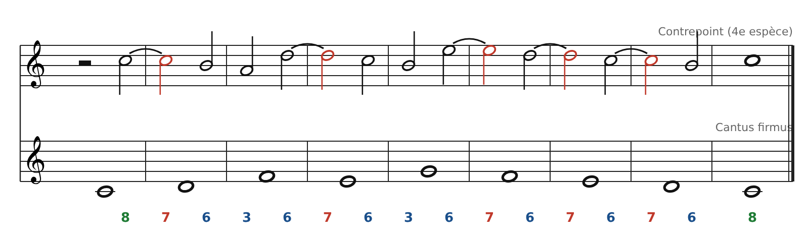
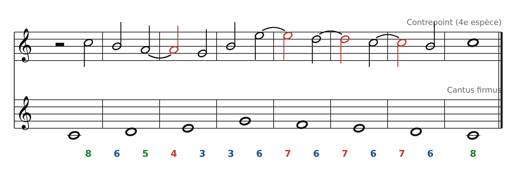

[← 6 bis. Troisième espèce : quatre notes contre une](07-troisieme-espece-quatre-notes-contre-une.md) · [Sommaire](../README.md#sommaire) · [7. En vraie musique : un contre-chant sur « Au clair de la lune » →](09-en-vraie-musique-un-contre-chant-sur-au-clair-de.md)

## 6 ter. Quatrième espèce : les syncopes

Le contrepoint est en **blanches décalées** : chaque blanche du temps faible est **liée** à la blanche du temps fort suivant. C'est l'espèce du **retard** (en anglais *suspension*), l'ancêtre du « sus4 ».

### Le retard en trois étapes

1.  **Préparation** (temps faible) : une note **consonante**.

2.  **Retard** (temps fort suivant) : la même note, liée. Le cantus a changé sous elle, elle devient souvent **dissonante**.

3.  **Résolution** (temps faible) : la note **descend d'un degré** vers une consonance.

### Les règles

1.  **Début** : une demi-pause, puis une blanche en consonance parfaite (8ve ou 5te).

2.  **Temps faibles** : toujours **consonants**.

3.  **Temps forts liés** : consonants (libres) ou dissonants. Un retard dissonant **se résout toujours en descendant d'un degré**.

4.  **Retards autorisés au-dessus du cantus** : **7 → 6** et **4 → 3**. On évite 9 → 8 au début et la quarte augmentée (Fa-Si).

5.  **Pas de 5tes ou 8ves sur deux temps faibles consécutifs.**

6.  **Rupture** : quand aucune liaison ne marche, on peut exceptionnellement écrire deux blanches non liées (comme en 2e espèce). À utiliser rarement.

7.  **Cadence** : retard 7 → 6 sur l'avant-dernière mesure (Do lié sur Ré, qui descend sur Si), puis l'octave Do.

### Exemple

Lecture mesure par mesure :

- **Mesure 2** : Do (préparé en 8ve) est lié au-dessus de Ré : **7e**, qui se résout sur Si (6te).

- **Mesures 3 et 5** : deux ruptures (La-Ré, Si-Mi) pour relancer la ligne vers le haut.

- **Mesures 4, 6, 7, 8** : une chaîne de retards **7 → 6**. C'est la formule la plus courante, et la plus belle à entendre.

- **Mesure 8** : la cadence classique : Do lié sur Ré (7e), résolution sur Si, puis Do.

**À la guitare** : joue le cantus en basse et le contrepoint en haut. Les retards s'entendent tout de suite comme des tensions qui se détendent.

### Exercice

Écris un contrepoint de 4e espèce au-dessus du **cantus firmus n°1** (même cantus que pour la 3e espèce). Vise au moins **deux retards dissonants**, et pas plus de deux ruptures.

**Conseil** : travaille à l'envers. Pars de la cadence (Do lié sur Ré → Si → Do) et remonte mesure par mesure : chaque résolution est une note plus haute d'un degré que la résolution qui suit.

### Corrigé (une solution possible)

(demi-pause) Do \| Si La \| ~La Sol \| Si Mi \| ~Mi Ré \| ~Ré Do \| ~Do Si \| Do. Le signe ~ indique une note liée. Retards : **4 → 3** en mesure 3 (La sur Mi), puis une chaîne de **7 → 6** en mesures 5, 6 et 7. Deux ruptures (mesures 2 et 4).

---

[← 6 bis. Troisième espèce : quatre notes contre une](07-troisieme-espece-quatre-notes-contre-une.md) · [Sommaire](../README.md#sommaire) · [7. En vraie musique : un contre-chant sur « Au clair de la lune » →](09-en-vraie-musique-un-contre-chant-sur-au-clair-de.md)
