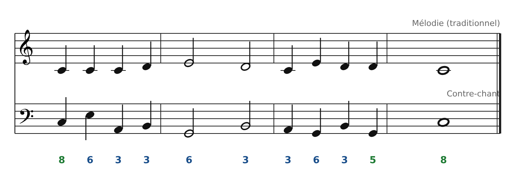

[← 6 ter. Quatrième espèce : les syncopes](08-quatrieme-espece-les-syncopes.md) · [Sommaire](../README.md#sommaire) · [8. Exercices →](10-exercices.md)

## 7. En vraie musique : un contre-chant sur « Au clair de la lune »

Les règles de la 1re espèce suffisent déjà à écrire une basse ou un contre-chant sur une chanson. Ici, la mélodie traditionnelle (domaine public) reçoit une ligne de basse **note contre note** : chaque note de la mélodie a sa note de basse, avec le même rythme.

Les chiffres donnent l'intervalle simple (une 10e est notée 3). On retrouve tout ce qu'on a appris :

- **Début et fin sur l'octave** (Do-Do).

- **Au milieu, que des 3ces et 6tes**, plus une 5te (Sol-Ré) atteinte par mouvement oblique, juste avant la cadence.

- **Mesure 1** : la mélodie répète Do trois fois, donc la basse bouge (mouvement oblique) pour éviter la monotonie.

- **Entre les mesures 1 et 2** : quand la mélodie monte (Ré-Mi), la basse descend (Si-Sol) : mouvement contraire.

**À essayer** : joue la mélodie à la guitare et demande à un élève de jouer la basse (ou l'inverse). Les deux voix sont simples séparément, mais ensemble elles sonnent déjà comme un petit duo.

**À écouter** (œuvres du domaine public) : les *Inventions à deux voix* de J.-S. Bach, les canons traditionnels (*Frère Jacques*), les messes de Palestrina. Dans chacune, repère les mouvements contraires et les 3ces/6tes parallèles.

---

[← 6 ter. Quatrième espèce : les syncopes](08-quatrieme-espece-les-syncopes.md) · [Sommaire](../README.md#sommaire) · [8. Exercices →](10-exercices.md)
