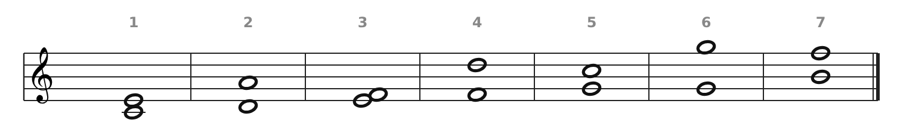
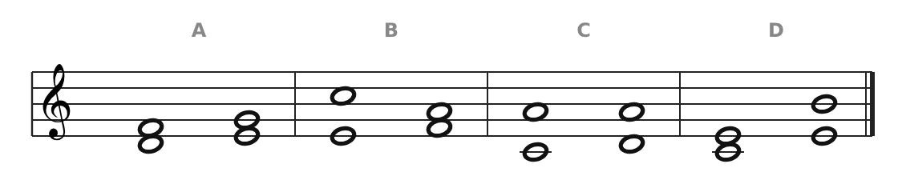
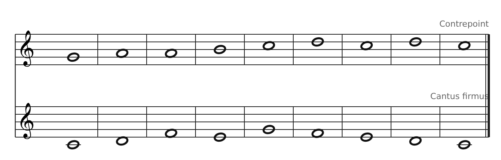
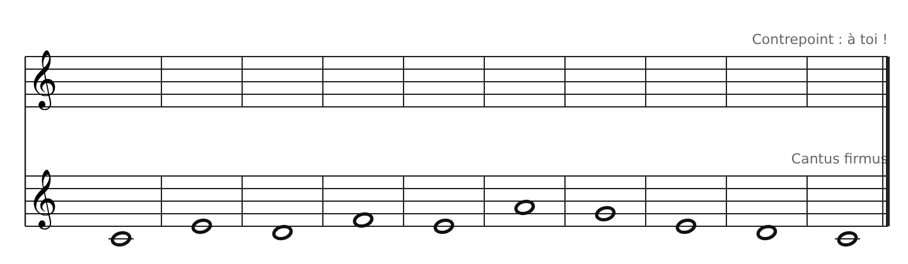
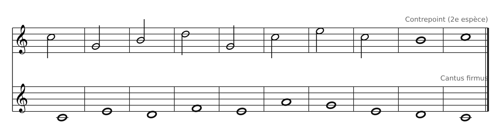

[← 7. En vraie musique : un contre-chant sur « Au clair de la lune »](09-en-vraie-musique-un-contre-chant-sur-au-clair-de.md) · [Sommaire](../README.md#sommaire) · [9. Corrigés →](11-corriges.md)

## 8. Exercices

Fais les exercices dans l'ordre, au crayon. Joue ou chante chaque résultat avant de regarder le corrigé.

### Exercice 1 : nommer les intervalles

Pour chaque intervalle, donne son nom (3ce, 5te…) et sa famille : consonance parfaite, consonance imparfaite ou dissonance.

### Exercice 2 : reconnaître les mouvements

Pour chaque mesure (A, B, C, D), indique le mouvement entre les deux intervalles : contraire, direct, oblique ou parallèle. **Bonus** : un de ces enchainements est interdit en contrepoint strict. Lequel, et pourquoi ?

### Exercice 3 : chasse aux fautes

Ce contrepoint de 1re espèce contient **trois fautes**. Écris les intervalles sous chaque mesure, puis trouve-les.

### Exercice 4 : écrire en 1re espèce

Écris un contrepoint note contre note au-dessus de ce cantus firmus en Do majeur (Do Mi Ré Fa Mi La Sol Mi Ré Do). Suis la méthode pas à pas de la partie 5 : commence par la fin.

### Exercice 5 : compléter en 2e espèce

Les temps forts sont déjà écrits. Ajoute une blanche sur chaque temps faible (mesures 1 à 8). Essaie d'utiliser **au moins trois notes de passage**.

---

[← 7. En vraie musique : un contre-chant sur « Au clair de la lune »](09-en-vraie-musique-un-contre-chant-sur-au-clair-de.md) · [Sommaire](../README.md#sommaire) · [9. Corrigés →](11-corriges.md)
