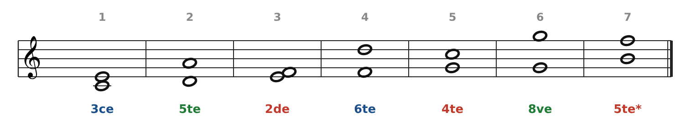
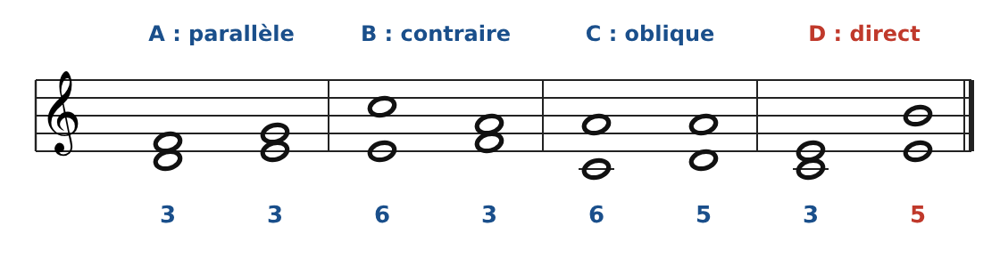
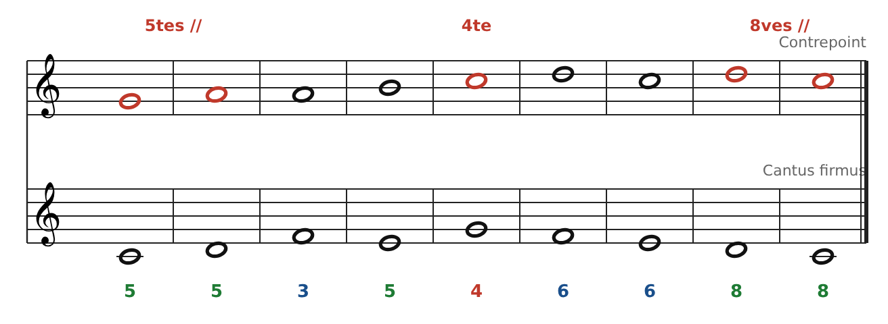
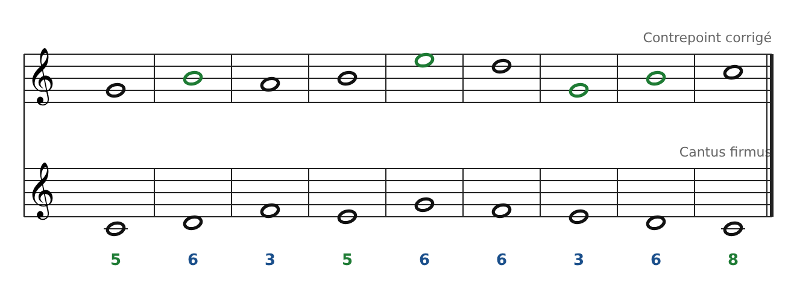
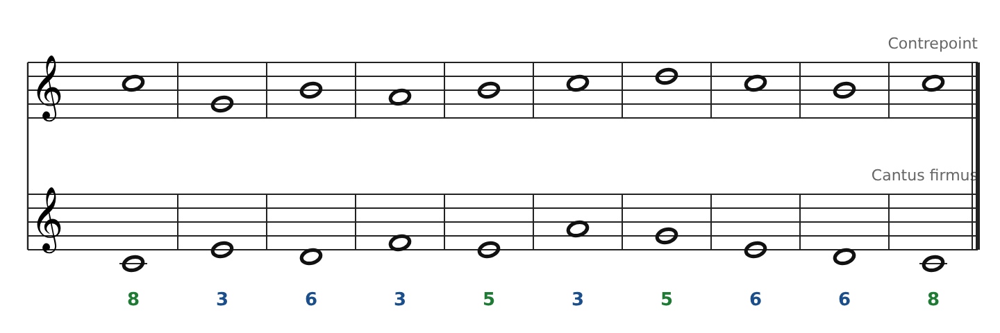
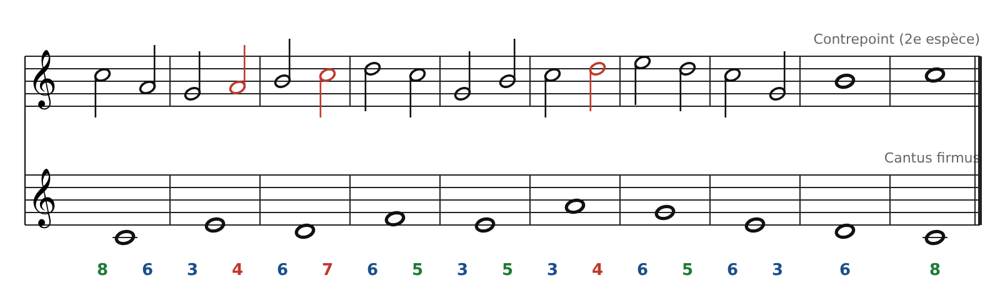

[← 8. Exercices](10-exercices.md) · [Sommaire](../README.md#sommaire) · [10. Banque de cantus firmus →](12-banque-de-cantus-firmus.md)

## 9. Corrigés

### Exercice 1

| N°  | Notes   | Intervalle     | Famille                            |
|-----|---------|----------------|------------------------------------|
| 1   | Do-Mi   | 3ce majeure    | Consonance imparfaite              |
| 2   | Ré-La   | 5te juste      | Consonance parfaite                |
| 3   | Mi-Fa   | 2de mineure    | Dissonance                         |
| 4   | Fa-Ré   | 6te majeure    | Consonance imparfaite              |
| 5   | Sol-Do  | 4te juste      | Dissonance (en contrepoint strict) |
| 6   | Sol-Sol | 8ve            | Consonance parfaite                |
| 7   | Si-Fa   | 5te diminuée\* | Dissonance                         |

\*Piège : Si-Fa ressemble à une 5te, mais elle ne compte que 6 demi-tons au lieu de 7. C'est le triton : on ne l'utilise jamais en 1re espèce.

### Exercice 2

- **A : parallèle** (3ce → 3ce). Autorisé.

- **B : contraire** (6te → 3ce). Le meilleur mouvement.

- **C : oblique** (6te → 5te). Autorisé : on peut arriver sur une 5te par mouvement oblique.

- **D : direct** (3ce → 5te). **C'est l'enchainement interdit** : une quinte directe (cachée), car on arrive sur une consonance parfaite avec les deux voix qui montent.

### Exercice 3

Intervalles : 5 - 5 - 3 - 5 - 4 - 6 - 6 - 8 - 8.

1.  **Mesures 1-2 : quintes parallèles** (Do-Sol puis Ré-La).

2.  **Mesure 5 : quarte** (Sol-Do), dissonance interdite en 1re espèce.

3.  **Mesures 8-9 : octaves parallèles** (Ré-Ré puis Do-Do). En plus, l'avant-dernière mesure devait être une 6te (Si au-dessus de Ré).

Une version corrigée possible (notes modifiées en vert) :

Si remplace La (mesure 2), Mi remplace Do (mesure 5), Si remplace Ré (mesure 8). Sol remplace Do en mesure 7 pour éviter quatre 6tes de suite. Intervalles : 5 - 6 - 3 - 5 - 6 - 6 - 3 - 6 - 8.

### Exercice 4

Il existe beaucoup de bonnes réponses. Voici une solution possible :

Contrepoint : Do Sol Si La Si Do Ré Do Si Do. Intervalles : 8 - 3 - 6 - 3 - 5 - 3 - 5 - 6 - 6 - 8.

Pour vérifier ta propre version, contrôle ces points :

- Début sur 8ve ou 5te, fin sur 8ve, avant-dernière note Si (6te).

- Aucune 2de, 4te ou 7e entre les voix.

- Les 5tes et 8ves sont atteintes par mouvement contraire ou oblique.

- Pas plus de trois 3ces ou 6tes de suite.

- Pas de note répétée, un seul point culminant, des sauts suivis d'un retour.

### Exercice 5

Temps faibles : La - La - Do - Do - Si - Ré - Ré - Sol. Les trois notes de passage dissonantes (en rouge) :

- **Mesure 2** : Sol-**La**-Si (4te avec Mi).

- **Mesure 3** : Si-**Do**-Ré (7e avec Ré).

- **Mesure 6** : Do-**Ré**-Mi (4te avec La).

Les autres temps faibles sont des consonances. D'autres réponses sont possibles : vérifie simplement qu'une dissonance est toujours prise et quittée par degré conjoint, dans la même direction, et qu'aucune 5te ou 8ve n'est atteinte par mouvement direct sur le temps fort suivant.

---

[← 8. Exercices](10-exercices.md) · [Sommaire](../README.md#sommaire) · [10. Banque de cantus firmus →](12-banque-de-cantus-firmus.md)
