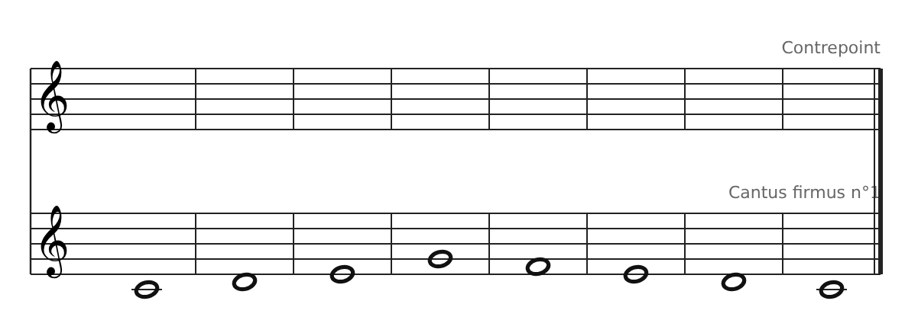
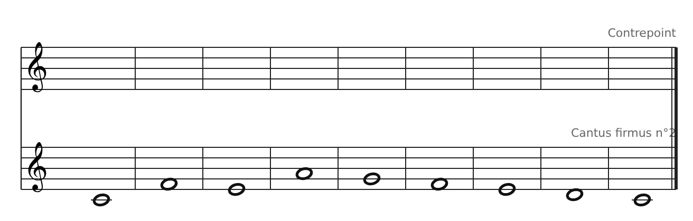
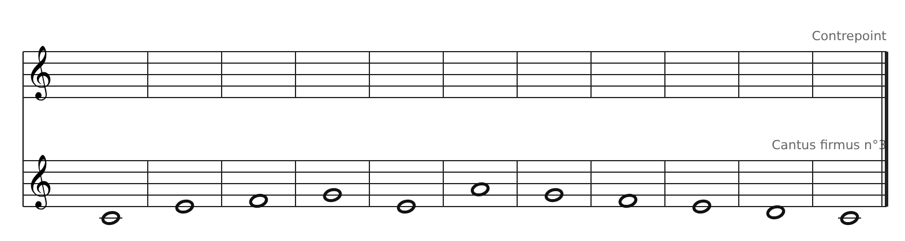
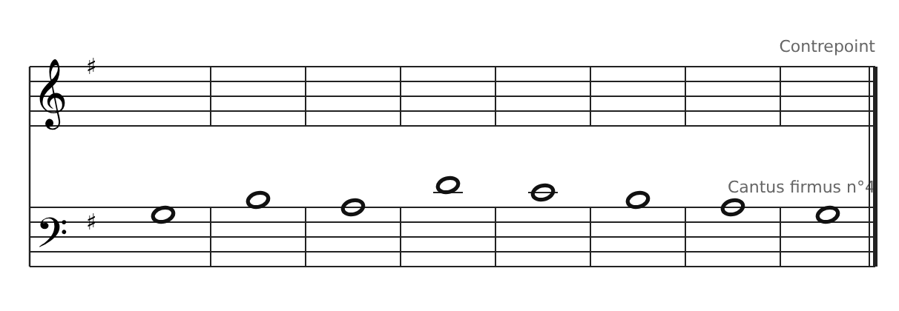
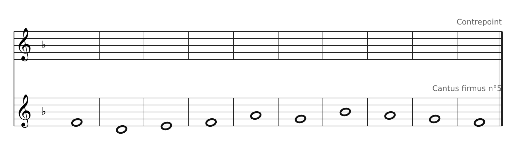
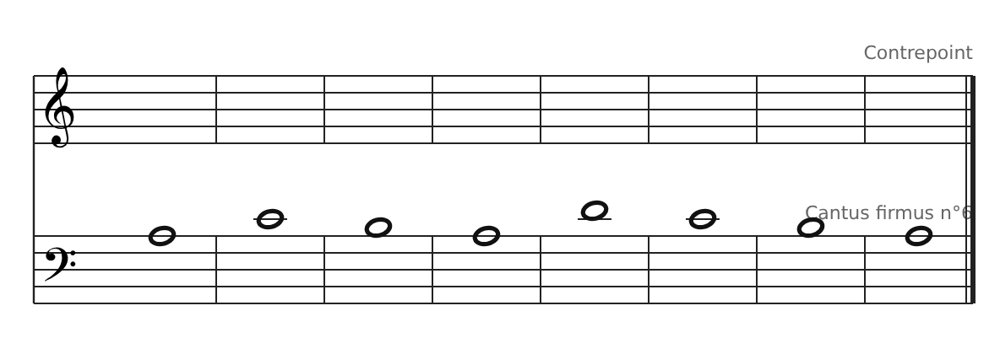
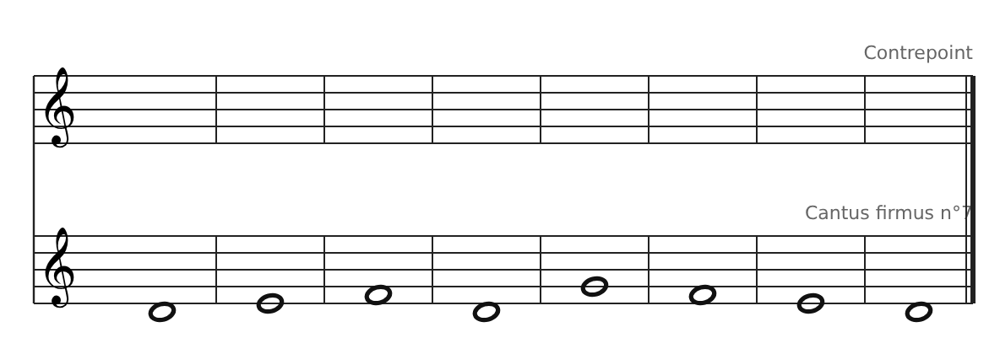

[← 9. Corrigés](11-corriges.md) · [Sommaire](../README.md#sommaire) · [11. Corrigés de la banque de cantus firmus →](13-corriges-de-la-banque-de-cantus-firmus.md)

## 10. Banque de cantus firmus

Sept sujets pour s'entraîner, du plus simple au plus riche. Pour chacun : **écris un contrepoint de 1re espèce au-dessus**. Pour les cantus 1, 3 et 6, écris aussi une **version en 2e espèce**. Imprime les portées vides et travaille au crayon.

| N°  | Tonalité               | Notes | Difficulté | À faire         |
|-----|------------------------|-------|------------|-----------------|
| 1   | Do majeur              | 8     | ★          | 1re + 2e espèce |
| 2   | Do majeur              | 9     | ★          | 1re espèce      |
| 3   | Do majeur              | 11    | ★★         | 1re + 2e espèce |
| 4   | Sol majeur (clé de fa) | 8     | ★★         | 1re espèce      |
| 5   | Fa majeur              | 10    | ★★         | 1re espèce      |
| 6   | La mineur (clé de fa)  | 8     | ★★★        | 1re + 2e espèce |
| 7   | Mode de Ré (dorien)    | 8     | ★★★        | 1re espèce      |

**Rappels pour les tonalités nouvelles** :

- **Sol majeur** : tous les Fa sont dièses ; la cadence finale est Fa♯ → Sol.

- **Fa majeur** : tous les Si sont bémols ; la cadence finale est Mi → Fa.

- **La mineur et mode de Ré** : la sensible n'est pas dans la gamme. On la hausse uniquement à l'avant-dernière mesure (Sol♯ en La mineur, Do♯ en Ré).

- Pour les cantus 4 et 6 en clé de fa, le contrepoint s'écrit en clé de sol, environ une octave plus haut. Compte les intervalles en simple (une 10e = une 3ce).

### Cantus firmus 1 (Do majeur)

### Cantus firmus 2 (Do majeur)

### Cantus firmus 3 (Do majeur)

### Cantus firmus 4 (Sol majeur)

### Cantus firmus 5 (Fa majeur)

### Cantus firmus 6 (La mineur)

### Cantus firmus 7 (mode de Ré)

---

[← 9. Corrigés](11-corriges.md) · [Sommaire](../README.md#sommaire) · [11. Corrigés de la banque de cantus firmus →](13-corriges-de-la-banque-de-cantus-firmus.md)
