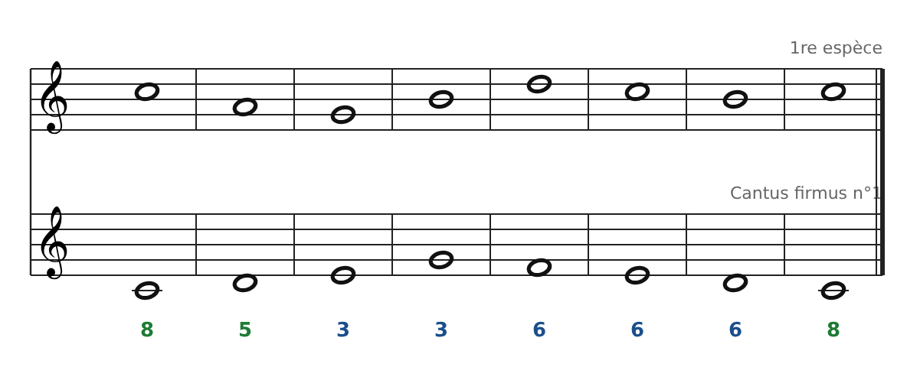
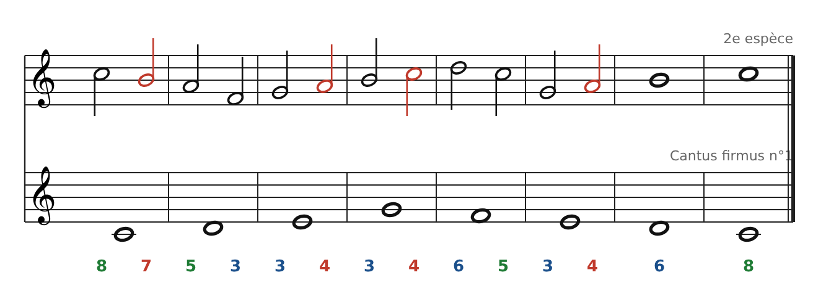
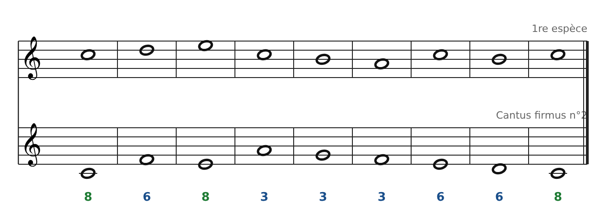
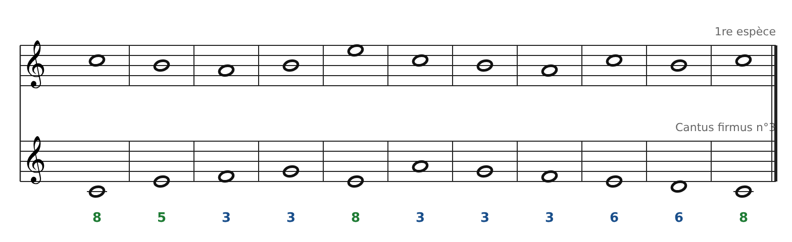
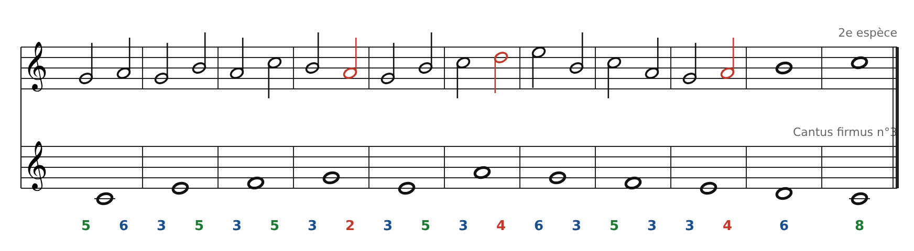
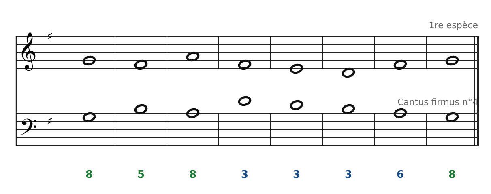
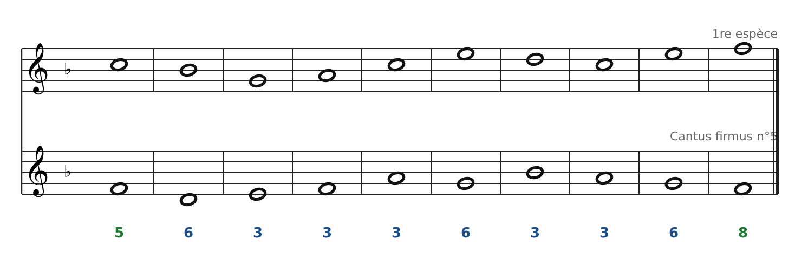
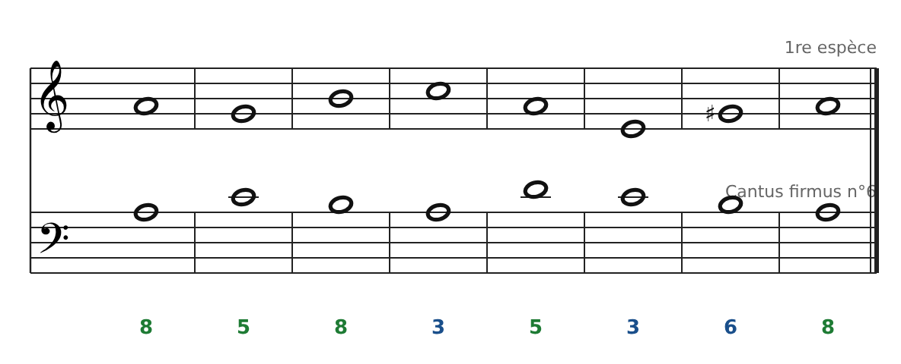
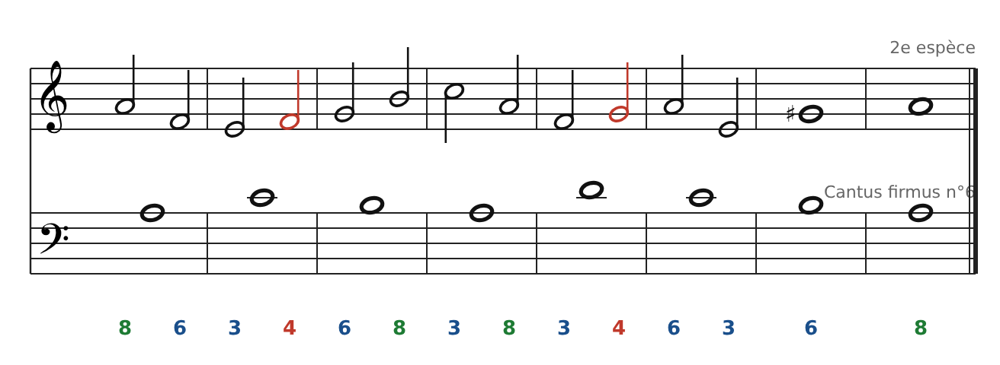
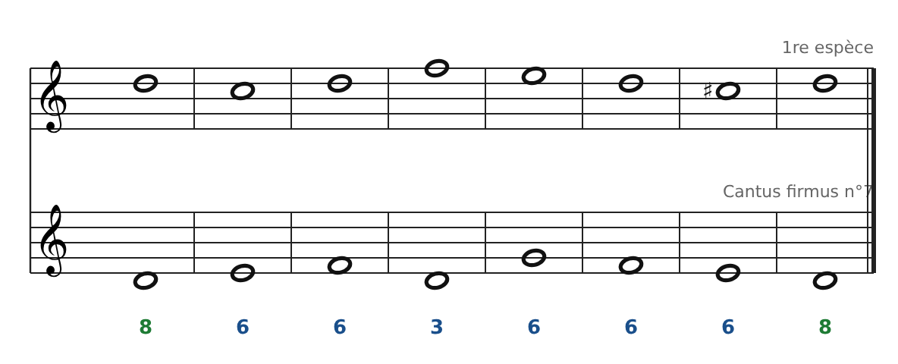

[← 10. Banque de cantus firmus](12-banque-de-cantus-firmus.md) · [Sommaire](../README.md#sommaire) · [12. L'imitation →](14-l-imitation.md)

## 11. Corrigés de la banque de cantus firmus

Chaque corrigé est **une solution possible parmi beaucoup d'autres**. Toutes ont été vérifiées règle par règle. Si ta version est différente, contrôle-la avec la liste de vérification de l'exercice 4.

### Cantus firmus 1

1re espèce : Do La Sol Si Ré Do Si Do (8 - 5 - 3 - 3 - 6 - 6 - 6 - 8). La 5te de la mesure 2 arrive par mouvement contraire.

2e espèce : Do Si \| La Fa \| Sol La \| Si Do \| Ré Do \| Sol La \| Si \| Do. Quatre notes de passage dissonantes (en rouge).

### Cantus firmus 2

Do Ré Mi Do Si La Do Si Do (8 - 6 - 8 - 3 - 3 - 3 - 6 - 6 - 8). L'octave de la mesure 3 (Mi-Mi) arrive par mouvement contraire : le cantus descend, le contrepoint monte.

### Cantus firmus 3

1re espèce : Do Si La Si Mi Do Si La Do Si Do (8 - 5 - 3 - 3 - 8 - 3 - 3 - 3 - 6 - 6 - 8). Le point culminant (Mi) tombe au milieu, sur une octave atteinte par mouvement contraire.

2e espèce : Sol La \| Sol Si \| La Do \| Si La \| Sol Si \| Do Ré \| Mi Si \| Do La \| Sol La \| Si \| Do.

### Cantus firmus 4

Sol Fa♯ La Fa♯ Mi Ré Fa♯ Sol (8 - 5 - 8 - 3 - 3 - 3 - 6 - 8). Remarque : le Fa♯ de la mesure 4 descend vers Mi sans résoudre. Seul le Fa♯ de la cadence monte obligatoirement sur Sol.

### Cantus firmus 5

Do Sib Sol La Do Mi Ré Do Mi Fa (5 - 6 - 3 - 3 - 3 - 6 - 3 - 3 - 6 - 8). La cadence Mi → Fa au-dessus de Sol → Fa joue le rôle de sensible → tonique.

### Cantus firmus 6

1re espèce : La Sol Si Do La Mi Sol♯ La (8 - 5 - 8 - 3 - 5 - 3 - 6 - 8). Le Sol de la mesure 2 reste naturel (mineur naturel). Seul celui de la cadence est haussé.

2e espèce : La Fa \| Mi Fa \| Sol Si \| Do La \| Fa Sol \| La Mi \| Sol♯ \| La. On évite Fa → Sol♯ (seconde augmentée) : on arrive sur Sol♯ depuis Mi.

### Cantus firmus 7

Ré Do Ré Fa Mi Ré Do♯ Ré (8 - 6 - 6 - 3 - 6 - 6 - 6 - 8). Trois 6tes parallèles à la fin : c'est le maximum autorisé. Le Do de la mesure 2 reste naturel ; le Do♯ n'apparaît qu'à la cadence.

---

[← 10. Banque de cantus firmus](12-banque-de-cantus-firmus.md) · [Sommaire](../README.md#sommaire) · [12. L'imitation →](14-l-imitation.md)
