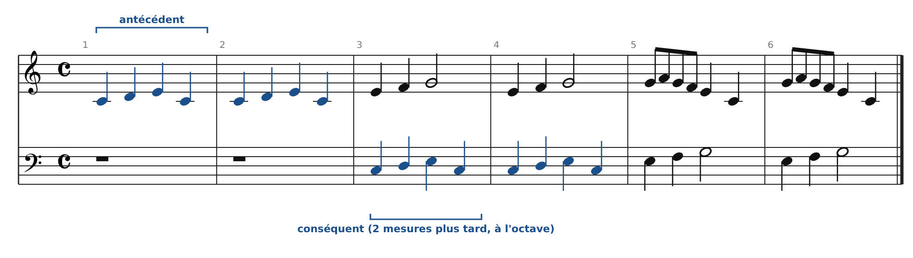
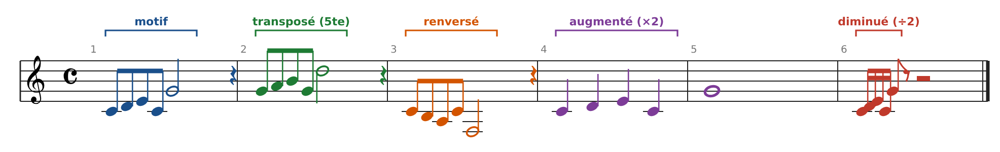
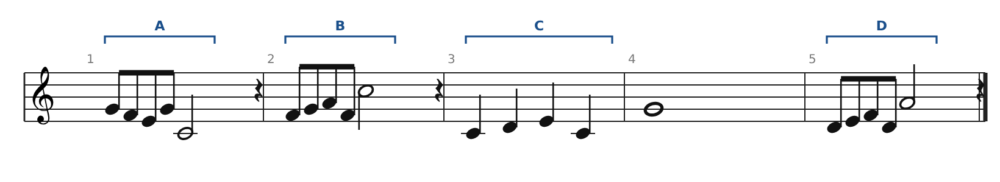
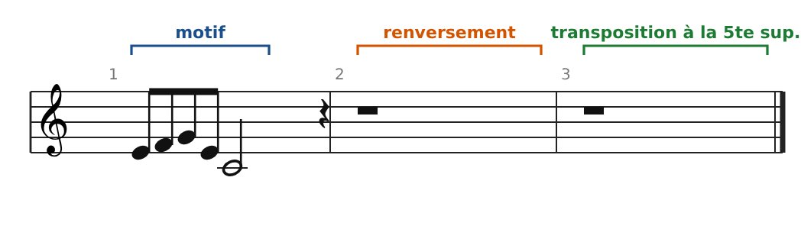
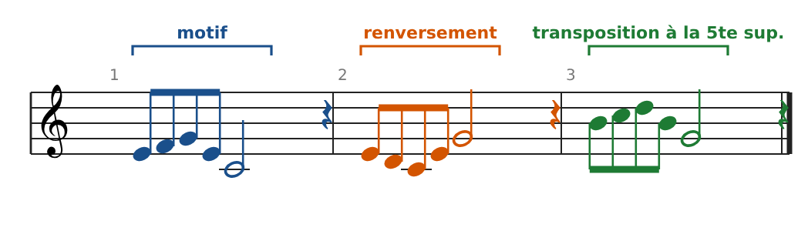

[← 11. Corrigés de la banque de cantus firmus](13-corriges-de-la-banque-de-cantus-firmus.md) · [Sommaire](../README.md#sommaire) · [12 bis. Miroir, rétrograde et canons savants →](15-miroir-retrograde-et-canons-savants.md)

# Deuxième partie : de l'imitation à la fugue

La première partie apprenait à faire chanter deux voix ensemble. Cette deuxième partie apprend à les faire **dialoguer** : une voix propose une idée, l'autre la reprend. C'est le principe de l'imitation, qui mène aux inventions de Bach, puis à la fugue.

## 12. L'imitation

Il y a **imitation** quand une voix reprend, un peu plus tard, une idée mélodique qu'une autre voix vient de jouer. La première voix est l'**antécédent**, celle qui imite est le **conséquent**.

### Les trois paramètres d'une imitation

| Paramètre             | Question à se poser                                    | Exemples                                                       |
|-----------------------|--------------------------------------------------------|----------------------------------------------------------------|
| **Distance**          | Au bout de combien de temps le conséquent entre-t-il ? | 1 temps, 2 temps, 1 mesure, 2 mesures                          |
| **Intervalle**        | À quelle hauteur reprend-il le motif ?                 | Unisson, octave, quinte, quarte                                |
| **Degré de fidélité** | Le motif est-il repris tel quel ou transformé ?        | Stricte (identique) ou libre (début seulement, rythme modifié) |

### Le canon : l'imitation stricte et continue

Dans un **canon**, le conséquent reprend **toute** la mélodie de l'antécédent, note pour note. *Frère Jacques* (traditionnel) en est l'exemple le plus connu : la deuxième voix entre deux mesures plus tard.

Pourquoi ça marche ? Parce que chaque fragment de deux mesures est un bon contrepoint pour le fragment précédent. Mesure 3 : la voix du haut chante Mi-Fa-Sol pendant que la basse chante Do-Ré-Mi-Do ; on retrouve surtout des 3ces et des 10es.

### Les transformations du motif

Un compositeur ne se contente pas de répéter son motif : il le **transforme**, tout en le gardant reconnaissable. Voici un motif (Do Ré Mi Do Sol) et ses cinq transformations classiques :

| Transformation                         | Principe                                                     | Dans l'exemple                         |
|----------------------------------------|--------------------------------------------------------------|----------------------------------------|
| **Transposition**                      | Même dessin, autre hauteur                                   | Sol La Si Sol Ré (à la 5te supérieure) |
| **Renversement** (mouvement contraire) | Chaque intervalle montant devient descendant, et inversement | Do Si La Do Fa                         |
| **Augmentation**                       | Valeurs rythmiques doublées                                  | Croches → noires, blanche → ronde      |
| **Diminution**                         | Valeurs rythmiques divisées par deux                         | Croches → doubles croches              |
| **Rétrograde** (plus rare)             | Le motif lu à l'envers                                       | Sol Do Mi Ré Do                        |

**Imitation réelle ou tonale ?** Si le conséquent garde exactement les mêmes intervalles (ton, ton…), l'imitation est **réelle**. S'il reste dans la gamme et que certains intervalles changent de qualité (un ton devient un demi-ton), elle est **tonale**. Dans l'exemple, le renversement est tonal : Do-Ré (un ton) devient Do-Si (un demi-ton). Cette distinction sera essentielle pour la fugue.

### Le contrepoint renversable

Quand deux voix échangent leur rôle (la mélodie du haut passe en bas et inversement), on parle de **contrepoint renversable à l'octave**. Chaque intervalle se transforme selon une règle simple : **l'intervalle et son renversement font toujours 9**.

| Intervalle  | 1   | 2   | 3   | 4   | 5   | 6   | 7   | 8   |
|-------------|-----|-----|-----|-----|-----|-----|-----|-----|
| **Devient** | 8   | 7   | 6   | 5   | 4   | 3   | 2   | 1   |

Les 3ces et 6tes restent des consonances imparfaites, l'octave devient un unisson. Mais **la 5te devient une 4te**, donc une dissonance. Pour écrire un contrepoint renversable, on évite les 5tes sur les temps forts, ou on les traite comme des dissonances (en passage). Bach utilise ce procédé dans l'Invention n°1 (chapitre 13).

### Exercices sur l'imitation

**Exercice A : reconnaître les transformations.** Chaque extrait (A, B, C, D) transforme le motif Do Ré Mi Do Sol. Nomme la transformation. Bonus : l'une des transpositions est tonale. Laquelle ?

**Exercice B : transformer un motif.** Écris le renversement de ce motif (en partant de Mi), puis sa transposition à la 5te supérieure.

**Exercice C : contrepoint renversable.** Deux voix forment les intervalles suivants : 3 - 5 - 6 - 8 - 6 - 3. Que deviennent-ils si on échange les voix à l'octave ? Quel intervalle pose problème ?

### Corrigés

**Exercice A**

- **A** : renversement, à partir de Sol (Sol Fa Mi Sol Do).

- **B** : transposition à la 4te supérieure (Fa Sol La Fa Do). Elle est réelle : Fa-Sol-La garde les deux tons de Do-Ré-Mi.

- **C** : augmentation (noires et ronde au lieu de croches et blanche).

- **D** : transposition à la 2de supérieure (Ré Mi Fa Ré La). **C'est la transposition tonale** : Mi-Fa est un demi-ton, alors que Do-Ré-Mi avait deux tons.

**Exercice B**

Renversement : Mi Ré Do Mi Sol (les deux degrés montants deviennent descendants, les deux tierces descendantes deviennent montantes). Transposition à la 5te : Si Do Ré Si Sol.

**Exercice C**

3 - 5 - 6 - 8 - 6 - 3 devient **6 - 4 - 3 - 1 - 3 - 6**. La 5te devient une **4te** : c'est une dissonance, interdite sur un temps fort. Il faudrait réécrire ce passage (par exemple une 3ce ou une 6te à la place de la 5te) pour qu'il soit renversable.

---

[← 11. Corrigés de la banque de cantus firmus](13-corriges-de-la-banque-de-cantus-firmus.md) · [Sommaire](../README.md#sommaire) · [12 bis. Miroir, rétrograde et canons savants →](15-miroir-retrograde-et-canons-savants.md)
