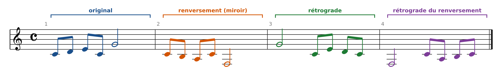
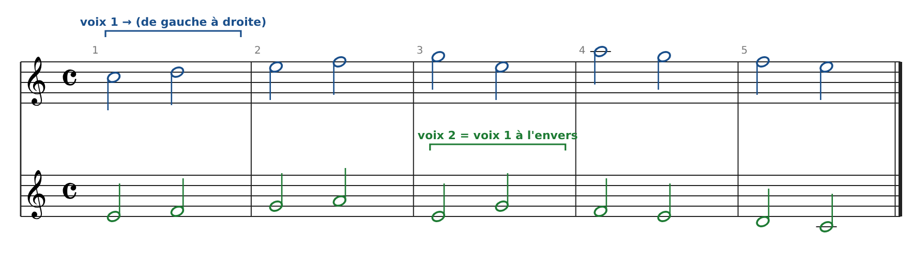
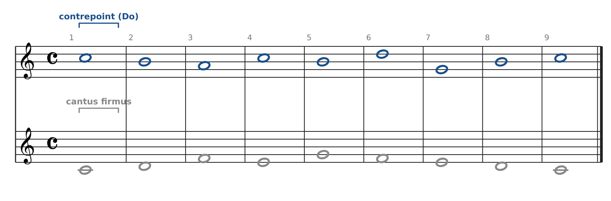
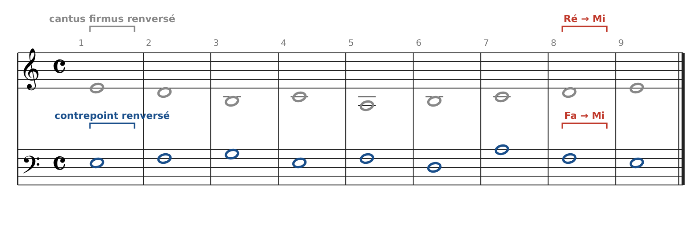
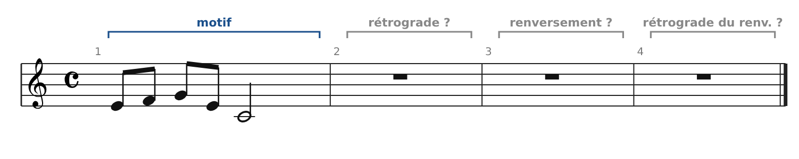
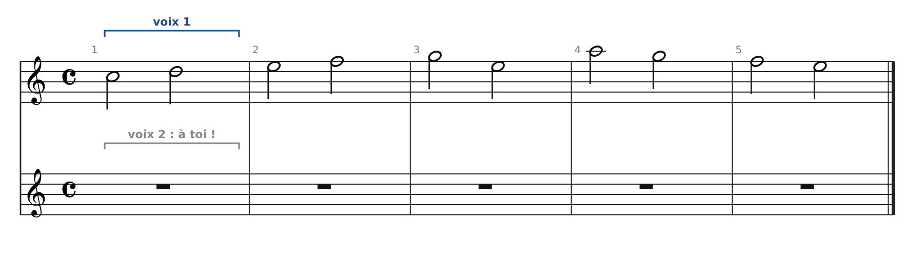
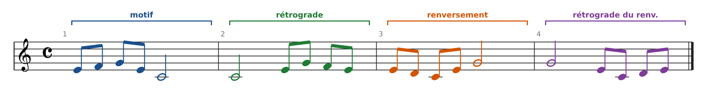

[← 12. L'imitation](14-l-imitation.md) · [Sommaire](../README.md#sommaire) · [13. Analyse : l'Invention n°1 en Do majeur de Bach (BWV 772) →](16-analyse-l-invention-n-1-en-do-majeur-de-bach-bwv.md)

## 12 bis. Miroir, rétrograde et canons savants

Au-delà de la transposition et de l'augmentation, les compositeurs ont exploré des transformations « géométriques » du motif. On les retrouve dans les canons et les fugues les plus savants de Bach.

### Les quatre formes d'un motif

Imagine le motif dessiné sur la portée : on peut le retourner de haut en bas (**miroir**), le lire de droite à gauche (**rétrograde**), ou faire les deux.

| Forme                                          | Principe                                                       | Exemple (Do Ré Mi Do Sol) |
|------------------------------------------------|----------------------------------------------------------------|---------------------------|
| **Original**                                   | Le motif tel quel                                              | Do Ré Mi Do Sol           |
| **Renversement** (miroir, mouvement contraire) | Chaque intervalle change de direction : ce qui montait descend | Do Si La Do Fa            |
| **Rétrograde** (écrevisse)                     | Le motif lu à l'envers, notes et rythme                        | Sol Do Mi Ré Do           |
| **Rétrograde du renversement**                 | Le miroir, lu à l'envers                                       | Fa Do La Si Do            |

Le renversement s'entend très bien, car le rythme et le profil restent reconnaissables. Le rétrograde, lui, est souvent difficile à reconnaître à l'oreille. C'est surtout un jeu d'écriture, que l'on perçoit en lisant la partition.

### Le canon à l'écrevisse (cancrizans)

Dans un **canon à l'écrevisse**, la deuxième voix joue la première **à l'envers, en même temps**. Bach en a écrit un célèbre dans l'*Offrande musicale* (1747, Canon a 2 cancrizans) : une seule ligne est notée, et l'interprète doit la jouer simultanément dans les deux sens.

Voici un petit canon à l'écrevisse en blanches, écrit pour ce cours. La voix 2 est exactement la voix 1 lue de la fin vers le début, une octave plus bas :

**Pourquoi c'est difficile à écrire** : la 1re note de la voix 1 sonne avec la dernière, la 2e avec l'avant-dernière, etc. Chaque paire de notes symétriques doit donc former une consonance, dans les deux sens. Ici, toutes les paires donnent des 3ces, des 6tes ou des 10es.

### Le contrepoint en miroir

Un passage est en **miroir** quand on peut renverser **toutes les voix à la fois** et obtenir une nouvelle musique correcte. Dans *L'Art de la fugue*, les Contrapunctus 12 et 13 existent ainsi en deux versions : *rectus* (droite) et *inversus* (renversée), où chaque voix est retournée. Dans *L'Offrande musicale*, Bach écrit aussi un canon par mouvement contraire (*Canon per motum contrarium*) et un canon par augmentation et mouvement contraire.

Essayons avec l'exemple de 1re espèce de la partie 5. On renverse chaque note autour de Ré (Mi devient Do, Fa devient Si, Sol devient La…) :

Ce que l'on observe :

- Les voix **échangent leur place** : le contrepoint, qui était au-dessus, passe en dessous.

- Les intervalles entre les voix sont **conservés** (une 6te reste une 6te), donc le contrepoint reste correct.

- Le **mode change** : l'original est en Do (mode de Do), le miroir finit sur Mi. La cadence devient Ré → Mi en haut et Fa → Mi en bas : c'est la **cadence phrygienne**, typique du mode de Mi.

- Pourquoi l'axe de Ré ? Parce que la gamme de Do est symétrique autour de Ré (ton-demi-ton-ton… se lit pareil dans les deux sens à partir de Ré). Le miroir garde donc exactement les tons et demi-tons.

### Exercices

**Exercice D : les quatre formes.** Écris le rétrograde, le renversement et le rétrograde du renversement de ce motif.

**Exercice E : canon à l'écrevisse.** Écris la voix 2 du canon : la voix 1 lue à l'envers, une octave plus bas. Puis vérifie les intervalles entre les deux voix sur chaque blanche.

### Corrigés

**Exercice D**

- **Rétrograde** : Do (blanche) puis Mi Sol Fa Mi (croches). Le rythme est lui aussi inversé.

- **Renversement** : Mi Ré Do Mi Sol (voir l'exercice B).

- **Rétrograde du renversement** : Sol (blanche) puis Mi Do Ré Mi.

**Exercice E** : la voix 2 est Mi Ré Fa Sol Mi La Sol Fa Ré Do, complète dans la figure du canon ci-dessus. Intervalles : 6 - 6 - 6 - 6 - 3 - 6 - 3 - 3 - 3 - 3 (en simple). Les paires sont symétriques : la 1re et la dernière blanche donnent une 6te et une 3ce (Do/Mi et Mi/Do), la 2e et l'avant-dernière aussi, etc. Ce sont les intervalles renversés l'un de l'autre, donc toujours consonants.

---

[← 12. L'imitation](14-l-imitation.md) · [Sommaire](../README.md#sommaire) · [13. Analyse : l'Invention n°1 en Do majeur de Bach (BWV 772) →](16-analyse-l-invention-n-1-en-do-majeur-de-bach-bwv.md)
