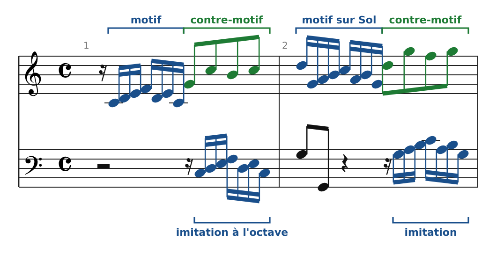
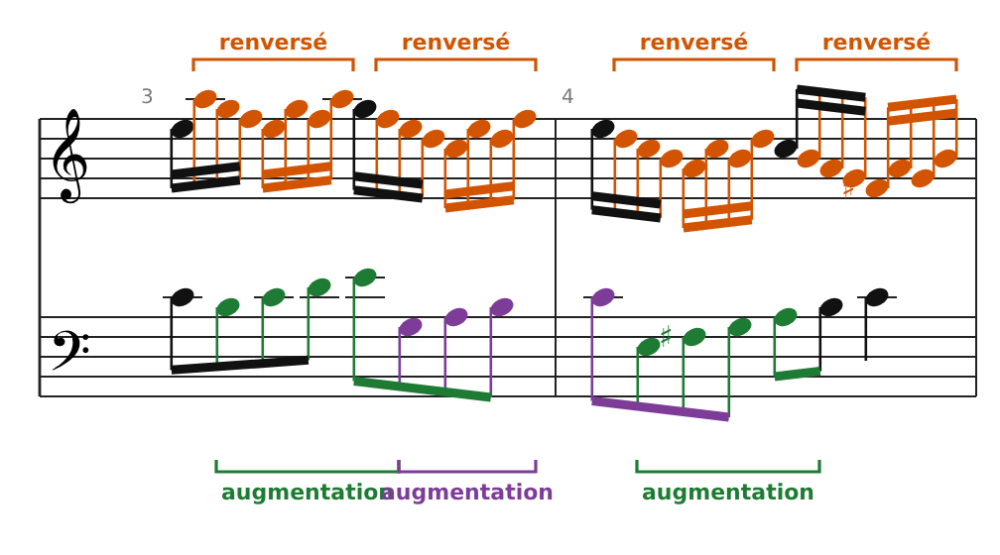
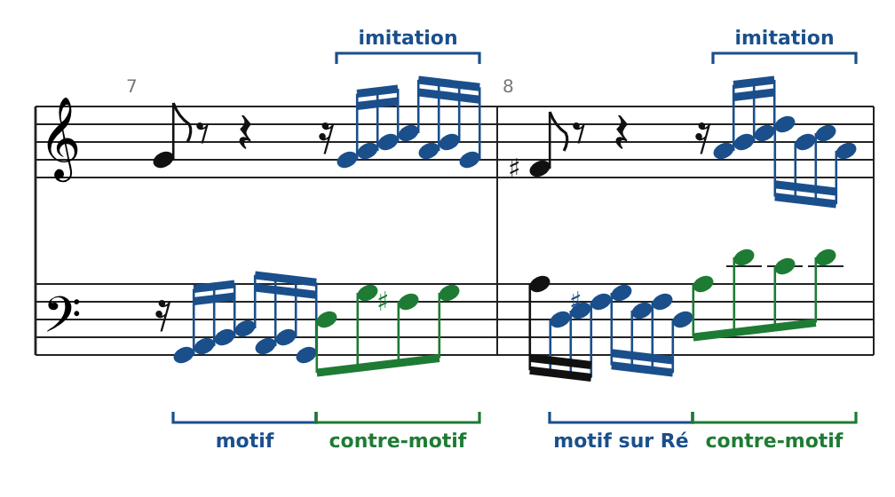
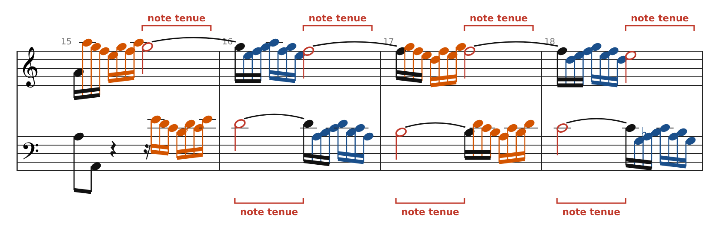
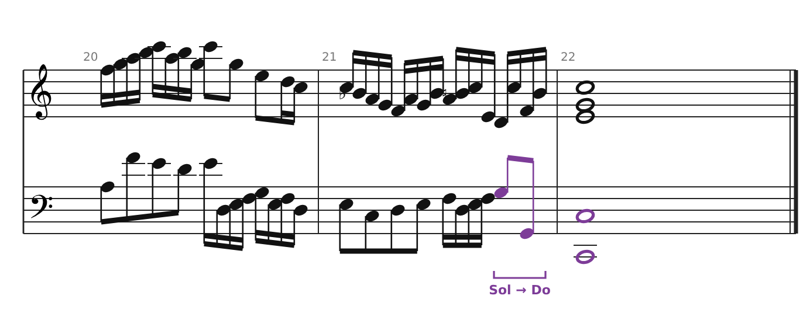
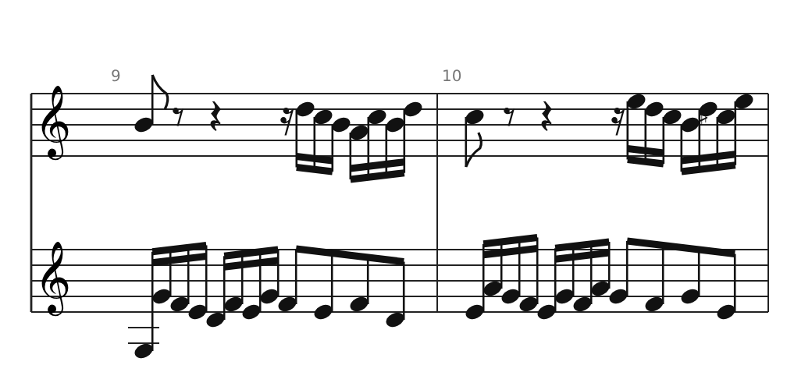
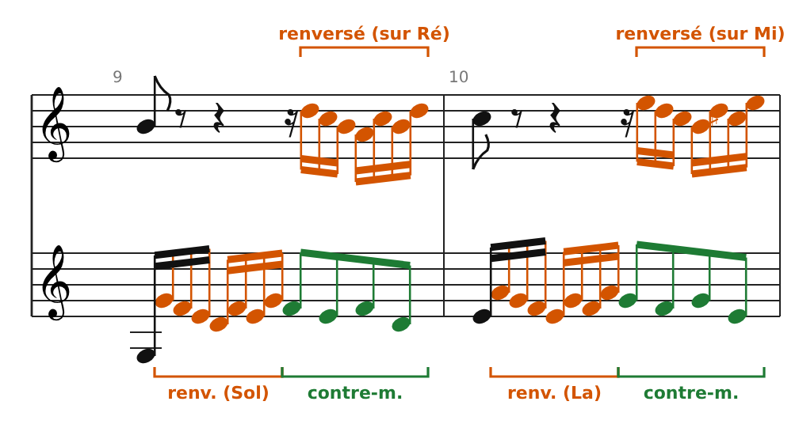

[← 12 bis. Miroir, rétrograde et canons savants](15-miroir-retrograde-et-canons-savants.md) · [Sommaire](../README.md#sommaire) · [14. La fugue : analyse de la Fugue en mi mineur (Clavier bien tempéré I, n°10, BWV 855) →](17-la-fugue-analyse-de-la-fugue-en-mi-mineur-clavie.md)

## 13. Analyse : l'Invention n°1 en Do majeur de Bach (BWV 772)

Les **15 Inventions à deux voix** sont des pièces pédagogiques pour clavier ; la copie autographe est datée de 1723. L'Invention n°1 fait 22 mesures à 4/4 et tient presque entièrement sur **un seul motif de sept notes**. C'est l'exemple idéal pour voir l'imitation et les transformations du chapitre 12 au travail.

Les extraits ci-dessous sont gravés d'après l'édition de la Bach-Gesellschaft. Code couleur : **bleu** = motif droit, **orange** = motif renversé, **vert** = contre-motif ou augmentation, **rouge** = note tenue.

### Le matériau : un motif et son contre-motif

- **Le motif** (main droite, mesure 1) : un quart de soupir, puis sept doubles croches Do Ré Mi Fa Ré Mi Do. Il monte par degrés (Do Ré Mi Fa), puis tourne sur lui-même (Ré Mi Do).

- **Le contre-motif** (main droite, temps 3-4) : quatre croches Sol Do Si Do, avec des sauts. Il contraste en rythme et en dessin avec le motif.

- **L'imitation** : la main gauche reprend le motif à l'octave inférieure, deux temps plus tard. Pendant ce temps, la main droite joue le contre-motif. On a donc **motif contre contre-motif**, exactement comme antécédent et conséquent dans un canon.

- **Mesure 2** : même chose, transposé sur Sol (la dominante).

### Le plan : trois parties, trois cadences

| Mesures | Tonalité              | Ce qui se passe                                                           |
|---------|-----------------------|---------------------------------------------------------------------------|
| 1-2     | Do majeur             | Exposition : motif à la main droite, imitation à la main gauche           |
| 3-6     | Do → Sol majeur       | Développement : motif renversé en séquence, tête du motif en augmentation |
| **7**   | **Sol majeur**        | **Cadence parfaite** (fin de la 1re partie)                               |
| 7-10    | Sol majeur            | Nouvelle exposition, voix échangées, puis motif renversé                  |
| 11-14   | ré mineur → la mineur | Séquences (Do♯, puis Sol♯)                                                |
| **15**  | **la mineur**         | **Cadence parfaite** (fin de la 2e partie)                                |
| 15-18   | ré mineur → Fa majeur | Séquence descendante : notes tenues contre motif                          |
| 19-21   | Fa → Do majeur        | Retour vers la tonique (Si♭ puis Si naturel)                              |
| **22**  | **Do majeur**         | **Cadence finale**                                                        |

Les cadences tombent sur des tonalités voisines de Do : la **dominante** (Sol), puis le **relatif mineur** (la). C'est le plan typique d'une invention, et ce sera aussi celui de nombreuses fugues.

### Le renversement et l'augmentation (mesures 3-4)

- **Main droite** : le motif est renversé (La Sol Fa Mi Sol Fa La), puis répété **une tierce plus bas** à chaque demi-mesure : sur La, sur Fa, sur Ré, sur Si. C'est une **marche** (ou séquence) descendante.

- **Main gauche** : les quatre premières notes du motif (la « tête », quatre degrés conjoints) reviennent en **croches** : c'est une augmentation. Elles forment elles aussi une séquence (Si-Do-Ré-Mi, Sol-La-Si-Do, Mi-Fa♯-Sol-La).

- Le Fa♯ de la mesure 4 annonce la modulation vers Sol majeur.

### Les voix échangées (mesures 7-8)

Après la cadence en Sol, Bach reprend l'exposition, mais **c'est la main gauche qui commence** : elle joue le motif puis le contre-motif, et la main droite imite. C'est le **contrepoint renversable** du chapitre 12 : le couple motif + contre-motif fonctionne dans les deux positions.

### Notes tenues contre motif (mesures 15-18)

Dans cette séquence descendante, une voix **tient une blanche** pendant que l'autre joue le motif, puis les rôles s'inversent à chaque demi-mesure. On retrouve les espèces de la première partie :

- La note tenue joue le rôle d'un **cantus firmus** ; la voix en doubles croches fait de la **3e espèce** : consonances sur les temps, dissonances de passage entre eux.

- Les blanches de la main droite sont **liées par-dessus la barre** (Sol, Fa, Mi) : c'est le principe de la **4e espèce**. Sous chaque note liée, la basse change, et la note tenue peut devenir dissonante (Fa contre Si, mesure 17) avant de redescendre.

- Les notes tenues dessinent une ligne descendante Sol-Fa-Mi : sous la surface très mobile, il y a un contrepoint simple, presque de la 1re espèce.

### La cadence finale (mesures 20-22)

À la mesure 21, le Si♭ de la main droite fait un dernier détour vers Fa majeur (la sous-dominante). Puis la basse joue **Sol → Do** (dominante → tonique) : c'est une cadence parfaite, qui conclut sur l'accord de Do majeur.

### À toi : analyse les mesures 9-10

Repère, dans chaque voix : où commence le motif ? Est-il droit ou renversé ? Sur quelle note commence-t-il ? Qui joue le contre-motif ? (À ces mesures, la main gauche est écrite en clé de sol.)

### Corrigé

- **Main gauche** : motif **renversé** sur Sol (mesure 9), puis sur La (mesure 10), suivi du contre-motif en croches.

- **Main droite** : elle imite à deux temps de distance, avec le motif **renversé** sur Ré, puis sur Mi.

- Chaque mesure reprend la précédente un degré plus haut : c'est une **marche ascendante**, qui mène vers ré mineur (Do♯, mesure 10).

### Pour aller plus loin

La fugue reprend tous ces outils, à plus grande échelle : un **sujet** (comme le motif), une **réponse** à la dominante (comme la mesure 2), un **contre-sujet** renversable (comme le contre-motif), des **épisodes** en marche (comme les mesures 3-6) et des cadences dans les tons voisins.

### Sources

- Partition : [Invention 1, BWV 772 — Mutopia Project](https://sca.uwaterloo.ca/Mutopia/cgibin/piece-info.cgi?id=40) (d'après la Bach-Gesellschaft)

- [Inventions and Sinfonias — Wikipedia](https://en.wikipedia.org/wiki/Inventions_and_Sinfonias)

- [Analyse de l'Invention n°1 — PTNA Piano Encyclopedia](https://enc.piano.or.jp/en/musics/22484)

---

[← 12 bis. Miroir, rétrograde et canons savants](15-miroir-retrograde-et-canons-savants.md) · [Sommaire](../README.md#sommaire) · [14. La fugue : analyse de la Fugue en mi mineur (Clavier bien tempéré I, n°10, BWV 855) →](17-la-fugue-analyse-de-la-fugue-en-mi-mineur-clavie.md)
