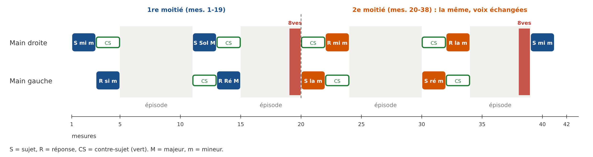
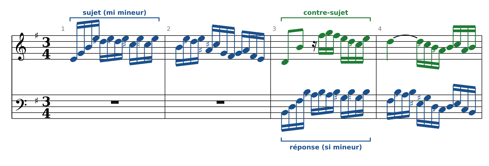
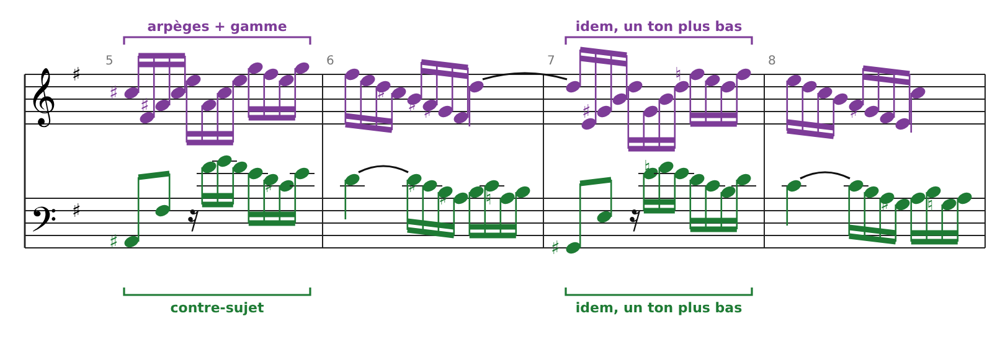
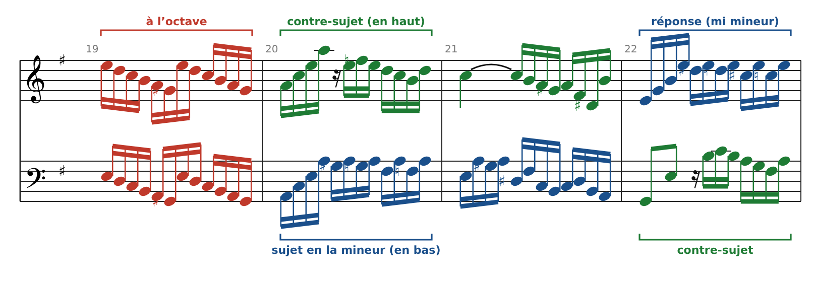
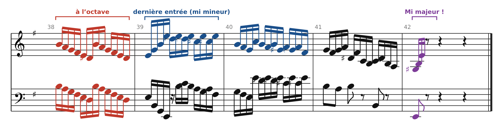
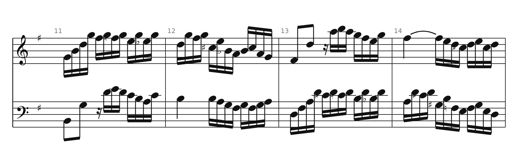
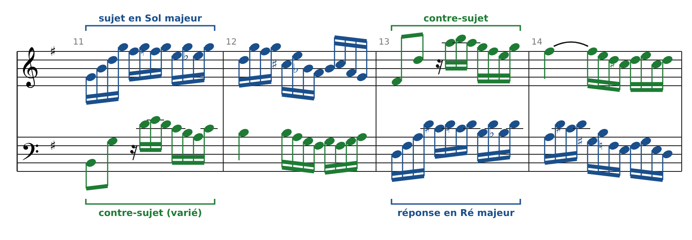

[← 13. Analyse : l'Invention n°1 en Do majeur de Bach (BWV 772)](16-analyse-l-invention-n-1-en-do-majeur-de-bach-bwv.md) · [Sommaire](../README.md#sommaire) · [15. Fugue à trois voix : la Fugue en do mineur (Clavier bien tempéré I, n°2, BWV 847) →](18-fugue-a-trois-voix-la-fugue-en-do-mineur-clavier.md)

## 14. La fugue : analyse de la Fugue en mi mineur (Clavier bien tempéré I, n°10, BWV 855)

C'est la **seule fugue à deux voix** du *Clavier bien tempéré*, et le pont idéal entre l'Invention n°1 et les fugues à trois ou quatre voix. Elle fait 42 mesures à 3/4 et date du premier livre (1722).

### Le vocabulaire de la fugue

| Terme                           | Définition                                                        | Équivalent dans l'Invention n°1 |
|---------------------------------|-------------------------------------------------------------------|---------------------------------|
| **Sujet**                       | Le thème principal, exposé seul au début                          | Le motif                        |
| **Réponse**                     | Le sujet repris par la 2e voix, à la dominante                    | Le motif sur Sol (mesure 2)     |
| Réponse **réelle** / **tonale** | Transposition exacte / légèrement adaptée pour rester dans le ton | Voir chapitre 12                |
| **Contre-sujet**                | Le contrepoint qui accompagne régulièrement le sujet              | Le contre-motif                 |
| **Exposition**                  | La présentation du sujet dans chaque voix                         | Mesures 1-2                     |
| **Divertissement** (ou épisode) | Passage sans sujet complet, souvent en marche, qui module         | Mesures 3-6                     |
| **Strette**                     | Entrées qui se chevauchent avant la fin du sujet                  | Absente ici                     |

Les extraits sont gravés d'après l'édition Breitkopf & Härtel de 1866 (domaine public). Code couleur : **bleu** = sujet ou réponse, **vert** = contre-sujet, **violet** = matériau d'épisode, **rouge** = passage à l'octave.

### Le plan d'ensemble

La fugue est construite en **deux moitiés presque identiques**. La seconde (mesures 20-38) reprend la première (mesures 1-19), mais **les deux mains échangent leur partie**, transposée une quarte plus haut. C'est le contrepoint renversable du chapitre 12, appliqué à toute une moitié de pièce. Une courte reprise du sujet (mesures 39-42) conclut.

| Mesures | Voix        | Événement                                             | Tonalité              |
|---------|-------------|-------------------------------------------------------|-----------------------|
| 1-2     | Main droite | Sujet, seul                                           | mi mineur             |
| 3-4     | Main gauche | Réponse (contre-sujet à la main droite)               | si mineur             |
| 5-10    | —           | Divertissement 1 (marche)                             | vers Sol majeur       |
| 11-12   | Main droite | Sujet                                                 | Sol majeur            |
| 13-14   | Main gauche | Réponse                                               | Ré majeur             |
| 15-19   | —           | Divertissement 2, terminé à l'octave                  | vers la mineur        |
| 20-21   | Main gauche | Sujet (début de la 2e moitié)                         | la mineur             |
| 22-23   | Main droite | Réponse                                               | mi mineur             |
| 24-29   | —           | Divertissement 3 (= divertissement 1, voix échangées) | vers ré mineur        |
| 30-31   | Main gauche | Sujet                                                 | ré mineur             |
| 32-33   | Main droite | Réponse                                               | la mineur             |
| 34-38   | —           | Divertissement 4, terminé à l'octave                  | vers mi mineur        |
| 39-42   | Main droite | Dernière entrée et cadence (tierce picarde)           | mi mineur → Mi majeur |

Remarque : les deux entrées centrales sont en **majeur** dans la première moitié (Sol, Ré), en **mineur** dans la seconde (ré, la).

### L'exposition (mesures 1-4)

- **Le sujet** dure deux mesures. Il commence par un arpège de mi mineur (Mi Sol Si Mi), puis alterne une note fixe (Mi) avec une ligne qui descend par demi-tons : Ré♯, Ré, Do♯, Do, Si. Une seule voix dessine donc **deux lignes** : une note répétée et une descente chromatique. C'est ce qu'on appelle une **polyphonie latente**.

- **La réponse** (main gauche, mesure 3) reprend le sujet exactement, une quinte plus haut (une quarte plus bas), en si mineur. Tous les intervalles sont conservés, jusqu'au Mi♯ : c'est une **réponse réelle**.

- **Le contre-sujet** (main droite, mesures 3-4) contraste avec le sujet : deux croches avec un grand saut, une gamme descendante, puis une **noire liée par-dessus la barre** (Ré). On retrouve la syncope de la 4e espèce.

- Avec deux voix seulement, l'exposition est finie après quatre mesures.

### Un divertissement en marche (mesures 5-8)

Le divertissement n'invente rien : il recycle le **contre-sujet** (main gauche) et le caractère du sujet (arpèges et gamme, main droite). Les mesures 7-8 répètent les mesures 5-6 **un ton plus bas** : c'est une marche, comme dans l'Invention n°1. Ce procédé permet de moduler en douceur vers Sol majeur.

### Le pivot : l'octave et l'échange des voix (mesures 19-22)

- **Mesure 19** : les deux mains jouent **la même ligne à l'octave**. C'est normalement une faute (octaves parallèles, partie 3), mais ici c'est un **effet voulu** : le contrepoint s'arrête un instant et tout l'espace se réduit à une seule ligne.

- On s'attend alors à ce que les deux voix jouent le sujet ensemble. Au début de la mesure 20, elles semblent le faire (La Do Mi La aux deux mains). Mais la main droite bifurque aussitôt vers le **contre-sujet**, tandis que la main gauche continue le **sujet**, en la mineur.

- Mesures 20-22 : compare avec les mesures 1-4. Le sujet est maintenant **en bas**, le contre-sujet **en haut**, puis la réponse passe en haut et le contre-sujet en bas. Le contre-sujet fonctionne au-dessus comme en dessous : il est **renversable à l'octave**.

### La fin (mesures 38-42)

Le même geste revient : une mesure à l'octave (38), puis la dernière entrée du sujet en mi mineur à la main droite (39-40), et une cadence. Le dernier accord est arpégé avec un **Sol♯** : la fugue en mineur finit sur un accord **majeur**. C'est la **tierce picarde**, très fréquente à l'époque baroque.

### Ce que cette fugue a en commun avec l'Invention n°1

- Un thème court, exposé seul puis imité dans l'autre voix.

- Un contrepoint associé (contre-motif / contre-sujet) qui accompagne le thème et peut passer au-dessus ou en dessous.

- Des passages en marche, construits avec des fragments du thème, pour moduler.

- Des cadences dans les tons voisins.

**Ce qui en fait une fugue** : le sujet est plus long et plus marqué (arpège et chromatisme), il entre systématiquement par paires sujet/réponse, et le plan, avec ses deux moitiés symétriques, est pensé à l'échelle de toute la pièce.

### Exercices

**Exercice A : analyse les mesures 11-14.** Où est le sujet ? Dans quel ton ? Qui joue le contre-sujet ? Le contre-sujet est-il identique à celui des mesures 3-4 ?

**Exercice B : comparer les deux moitiés.** Écoute ou joue les mesures 5-6, puis les mesures 24-25. Qu'est-ce qui a changé ?

**Exercice C : la réponse.** Transpose les quatre premières notes du sujet (Mi Sol Si Mi) pour obtenir le début de la réponse. Pourquoi y a-t-il un Mi♯ dans la réponse, mesure 4 ?

### Corrigés

**Exercice A**

- **Mesures 11-12** : sujet à la main droite, en **Sol majeur** (Sol Si Ré Sol, puis Fa♯, Fa, Mi, Mi♭…). Contre-sujet à la main gauche.

- **Mesures 13-14** : réponse à la main gauche, en **Ré majeur**. Contre-sujet à la main droite.

- Le contre-sujet de la main gauche est **varié** : à la mesure 12, la noire Si n'est pas liée et la fin du dessin change. Bach adapte souvent le contre-sujet à la tonalité ou à la tessiture.

**Exercice B** : la matière est la même, mais **les deux mains ont échangé leur partie**. Les arpèges passent à la main gauche, le contre-sujet à la main droite, le tout transposé.

**Exercice C** : une quinte au-dessus de Mi Sol Si Mi, on obtient **Si Ré Fa♯ Si**. La réponse est réelle : chaque intervalle du sujet est reproduit exactement. Le La♯ du sujet (mesure 2) devient donc Mi♯ dans la réponse (mesure 4) : c'est la sensible de Fa♯, la dominante de si mineur.

### Sources

- Partition : [Das Wohltemperierte Clavier I, Fuga X — Mutopia Project](https://www.mutopiaproject.org) (édition Breitkopf & Härtel, 1866, domaine public)

- [Prelude and Fugue in E minor, BWV 855 — Wikipedia](https://en.wikipedia.org/wiki/Prelude_and_Fugue_in_E_minor,_BWV_855)

- [Book 1, No. 10, E minor, Fugue — Earsense](https://www.earsense.org/Earsense/WTC/Book1/10/words.html)

---

[← 13. Analyse : l'Invention n°1 en Do majeur de Bach (BWV 772)](16-analyse-l-invention-n-1-en-do-majeur-de-bach-bwv.md) · [Sommaire](../README.md#sommaire) · [15. Fugue à trois voix : la Fugue en do mineur (Clavier bien tempéré I, n°2, BWV 847) →](18-fugue-a-trois-voix-la-fugue-en-do-mineur-clavier.md)
