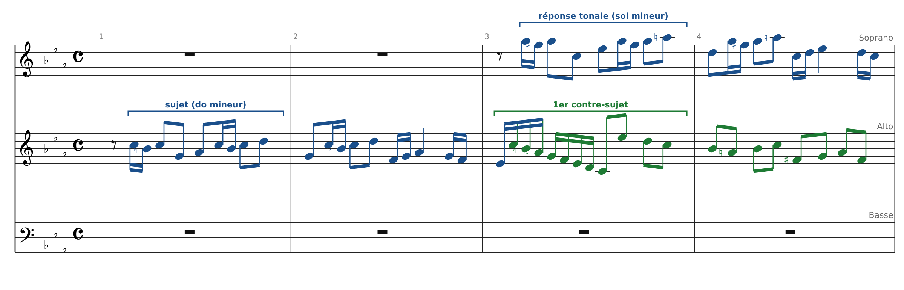
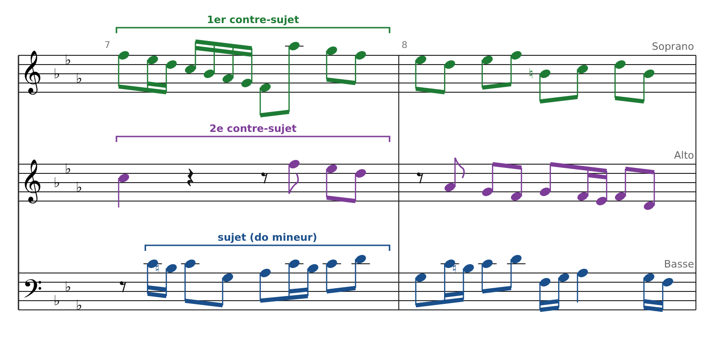
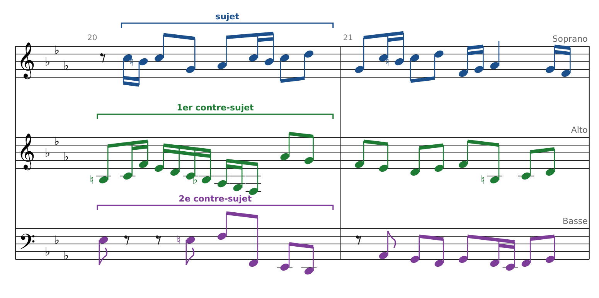
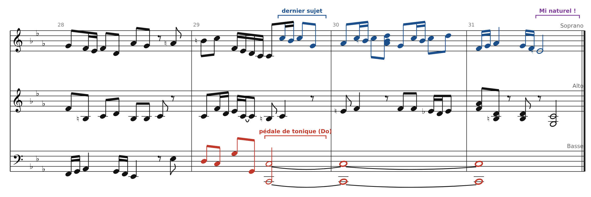
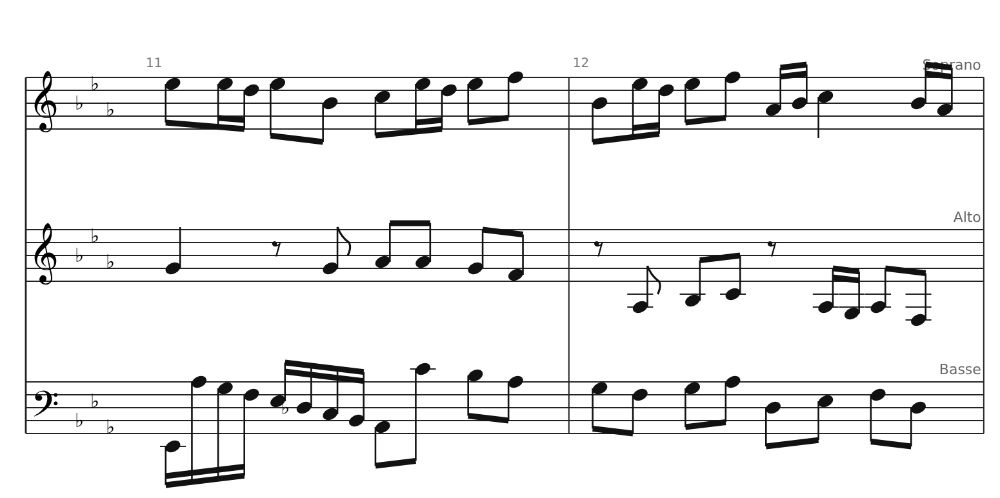
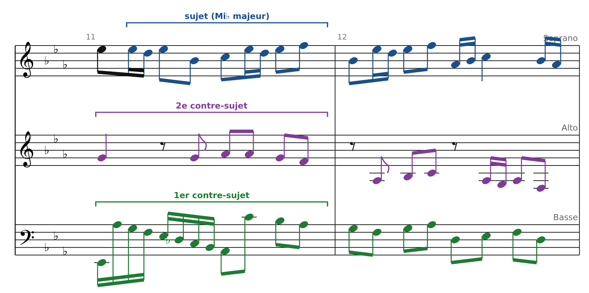

[← 14. La fugue : analyse de la Fugue en mi mineur (Clavier bien tempéré I, n°10, BWV 855)](17-la-fugue-analyse-de-la-fugue-en-mi-mineur-clavie.md) · [Sommaire](../README.md#sommaire) · [16. Fugue à quatre voix : la Fugue en Do majeur (Clavier bien tempéré I, n°1, BWV 846) →](19-fugue-a-quatre-voix-la-fugue-en-do-majeur-clavie.md)

## 15. Fugue à trois voix : la Fugue en do mineur (Clavier bien tempéré I, n°2, BWV 847)

Avec une troisième voix, deux nouveautés apparaissent : la **réponse tonale** et le **contrepoint triple** (deux contre-sujets qui tournent entre les voix). La fugue fait 31 mesures à 4/4.

Extraits gravés d'après l'édition Peters (via le Mutopia Project), une portée par voix pour la lisibilité. Code couleur : **bleu** = sujet ou réponse, **vert** = 1er contre-sujet, **violet** = 2e contre-sujet, **rouge** = pédale.

### L'exposition et la réponse tonale (mesures 1-4)

- **Le sujet** (alto) dure deux mesures. Il commence par une broderie rapide (Do-Si-Do), puis saute à la quarte inférieure (Sol). Son rythme de doubles croches et de croches détachées le rend très reconnaissable.

- **La réponse** (soprano, mesure 3) est en sol mineur. Mais elle n'est pas une transposition exacte : le sujet fait Do-Si-Do-**Sol** (quarte descendante), la réponse fait Sol-Fa♯-Sol-**Do** (quinte descendante). C'est une **réponse tonale** : Bach modifie un intervalle pour que la réponse commence en restant attachée à la tonique Do.

- **Le 1er contre-sujet** (alto, mesures 3-4) : une gamme descendante en doubles croches, puis des croches. Il contraste avec le sujet par sa direction et sa continuité.

- Entre la réponse et la 3e entrée, deux mesures de liaison (5-6), appelées **codetta**, ramènent le ton de do mineur.

### Le contrepoint triple (mesures 7-8, 11-12 et 20-21)

À l'entrée de la basse (mesure 7), les trois voix jouent **trois lignes complémentaires** :

- le **sujet** (basse) : doubles croches en broderie, mouvement continu ;

- le **1er contre-sujet** (soprano) : gamme descendante ;

- le **2e contre-sujet** (alto) : une ligne plus calme, qui commence par une note longue et des silences.

Ces trois lignes sont écrites pour fonctionner **dans n'importe quel ordre** de superposition. Bach les fait tourner entre les voix :

| Mesures | Soprano                | Alto             | Basse            |
|---------|------------------------|------------------|------------------|
| 7-8     | 1er contre-sujet       | 2e contre-sujet  | **Sujet**        |
| 11-12   | **Sujet** (Mi♭ majeur) | 2e contre-sujet  | 1er contre-sujet |
| 20-21   | **Sujet**              | 1er contre-sujet | 2e contre-sujet  |

C'est le contrepoint renversable du chapitre 12, étendu à trois voix : on parle de **contrepoint triple**. Il faut éviter les quintes sur les temps forts entre chaque paire de lignes, puisqu'elles deviendraient des quartes une fois les voix permutées.

### Le plan

| Mesures | Événement                                           | Tonalité              |
|---------|-----------------------------------------------------|-----------------------|
| 1-2     | Sujet (alto)                                        | do mineur             |
| 3-4     | Réponse tonale (soprano)                            | sol mineur            |
| 5-6     | Codetta                                             | retour à do mineur    |
| 7-8     | Sujet (basse) : fin de l'exposition                 | do mineur             |
| 9-10    | Divertissement                                      | vers Mi♭ majeur       |
| 11-12   | Sujet (soprano)                                     | Mi♭ majeur (relatif)  |
| 13-14   | Divertissement                                      | vers sol mineur       |
| 15-16   | Sujet (alto)                                        | sol mineur            |
| 17-19   | Divertissement                                      | vers do mineur        |
| 20-21   | Sujet (soprano)                                     | do mineur             |
| 22-25   | Divertissement (marche à la basse)                  |                       |
| 26-28   | Sujet (basse), puis cadence                         | do mineur             |
| 29-31   | Coda sur pédale de tonique, dernier sujet (soprano) | do mineur → Do majeur |

La fugue compte **huit entrées** du sujet. Les divertissements sont construits avec des fragments du sujet et des contre-sujets, souvent en marche.

### La coda (mesures 28-31)

La basse tient un **Do grave** (pédale de tonique) pendant les trois dernières mesures. Au-dessus, le soprano chante une dernière fois le sujet, et les voix intérieures s'épaississent en accords. Le dernier accord est majeur grâce au **Mi naturel** du soprano : encore une tierce picarde.

### Exercice

Analyse les mesures 11-12 : quelle voix a le sujet, dans quel ton ? Qui joue le 1er et le 2e contre-sujet ?

### Corrigé

- **Soprano** : le sujet en **Mi♭ majeur** (Mi♭-Ré-Mi♭-Si♭…), le relatif majeur de do mineur.

- **Alto** : le 2e contre-sujet (notes plus longues, avec des silences).

- **Basse** : le 1er contre-sujet (gamme descendante en doubles croches).

Par rapport aux mesures 7-8, le sujet est passé de la basse au soprano, et les deux contre-sujets ont changé de place.

### Sources

- Partition : Das Wohltemperierte Clavier I, Fuga II, BWV 847, édition Peters, [Mutopia Project](https://www.mutopiaproject.org)

---

[← 14. La fugue : analyse de la Fugue en mi mineur (Clavier bien tempéré I, n°10, BWV 855)](17-la-fugue-analyse-de-la-fugue-en-mi-mineur-clavie.md) · [Sommaire](../README.md#sommaire) · [16. Fugue à quatre voix : la Fugue en Do majeur (Clavier bien tempéré I, n°1, BWV 846) →](19-fugue-a-quatre-voix-la-fugue-en-do-majeur-clavie.md)
