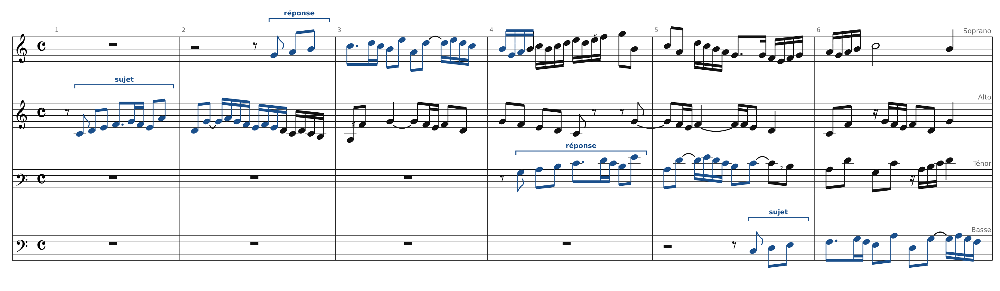
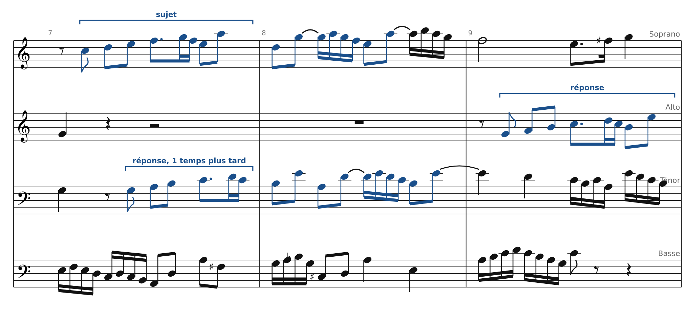
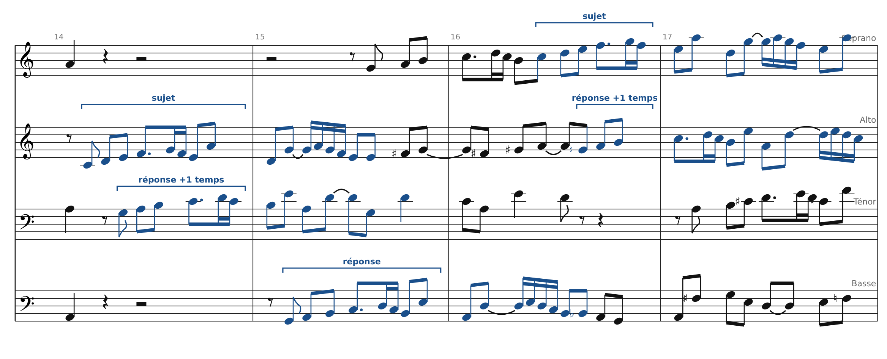
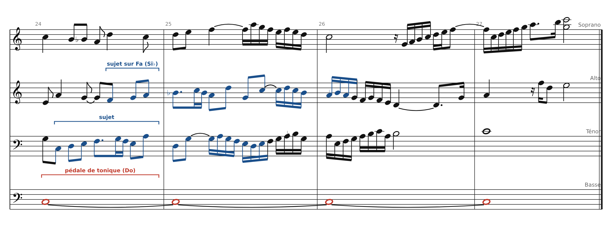
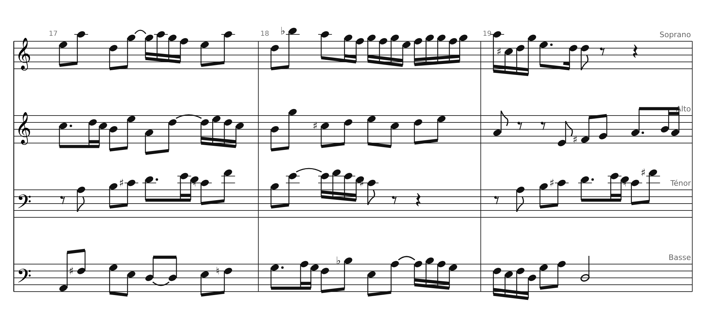
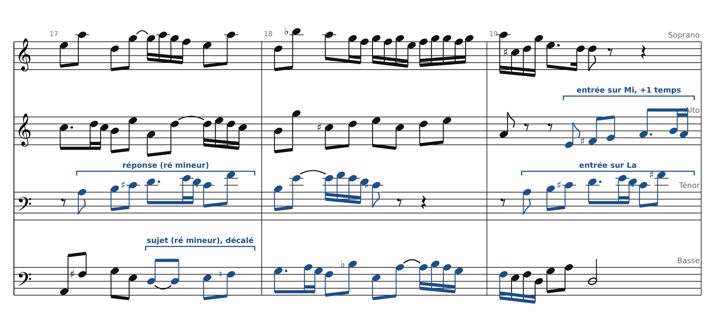

[← 15. Fugue à trois voix : la Fugue en do mineur (Clavier bien tempéré I, n°2, BWV 847)](18-fugue-a-trois-voix-la-fugue-en-do-mineur-clavier.md) · [Sommaire](../README.md#sommaire) · [17. Atelier : écrire le début d'une fugue →](20-atelier-ecrire-le-debut-d-une-fugue.md)

## 16. Fugue à quatre voix : la Fugue en Do majeur (Clavier bien tempéré I, n°1, BWV 846)

La première fugue du recueil est à **quatre voix** et ne dure que 27 mesures. Elle est célèbre pour une particularité : elle n'a presque **pas de divertissements** et **pas de contre-sujet fixe**. Le sujet revient sans cesse, souvent en **strette** : une nouvelle entrée commence avant la fin de la précédente.

Extraits gravés d'après l'édition du Mutopia Project (domaine public), une portée par voix. **Bleu** = entrées du sujet, **rouge** = pédale.

### Le sujet

Il monte par degrés (Do Ré Mi Fa), avec un petit ornement rythmique (croche pointée + triple croche), puis redescend et bondit (Mi La Ré Sol). Il dure un peu plus d'une mesure et demie. Sa tête en gamme montante rappelle le motif de l'Invention n°1.

### L'exposition à quatre voix (mesures 1-6)

Les voix entrent l'une après l'autre, en alternant sujet et réponse :

| Ordre | Voix    | Mesure | Forme            | Première note |
|-------|---------|--------|------------------|---------------|
| 1     | Alto    | 1      | Sujet            | Do            |
| 2     | Soprano | 2      | Réponse (réelle) | Sol           |
| 3     | Ténor   | 4      | Réponse          | Sol           |
| 4     | Basse   | 5      | Sujet            | Do            |

Remarque l'ordre : on ne va pas forcément de l'aigu au grave. Chaque voix qui a fini son entrée continue en contrepoint libre (en noir).

### La strette (mesures 7-9)

Mesure 7 : le soprano commence le sujet, et le ténor commence la réponse **un temps plus tard**, alors que le soprano n'a pas fini. Les deux entrées se chevauchent presque entièrement : c'est une **strette**. Pour que ça marche, le sujet doit former un bon contrepoint avec lui-même décalé d'un temps. Bach a choisi son sujet en conséquence.

### Des strettes en cascade (mesures 14-17)

Après une cadence en la mineur (mesure 14), les entrées s'enchaînent à toutes les voix : alto, puis ténor un temps plus tard ; basse ; soprano, puis alto un temps plus tard. À certains moments, trois voix sur quatre chantent le sujet en même temps.

### Le plan

| Mesures | Événement                          | Tonalité                                    |
|---------|------------------------------------|---------------------------------------------|
| 1-6     | Exposition (A, S, T, B)            | Do majeur                                   |
| 7-9     | Strette S/T, puis entrée de l'alto | Do → Sol majeur                             |
| 10-14   | Entrées en strette, modulation     | vers la mineur (cadence mesure 14)          |
| 14-16   | Strettes à trois ou quatre voix    | Do / Sol majeur                             |
| 17-19   | Entrées en mineur                  | ré mineur → mi mineur                       |
| 20-23   | Dernières entrées                  | retour à Do majeur                          |
| 24-27   | Pédale de tonique, entrées finales | Do majeur (Si♭ : couleur de sous-dominante) |

Le sujet apparaît **plus de vingt fois** en 27 mesures. Il y a donc très peu de place pour autre chose : toute la fugue est une suite d'entrées plus ou moins rapprochées.

### La pédale finale (mesures 24-27)

La basse tient un **Do** pendant quatre mesures. Au-dessus, le ténor puis l'alto chantent encore le sujet. L'entrée de l'alto commence sur Fa, avec un Si♭ : c'est une couleur de **sous-dominante**, typique des fins de fugue. Elle donne l'impression de « redescendre » avant la cadence finale.

### Exercice

Analyse les mesures 17-19. Combien d'entrées vois-tu ? Dans quelles voix ? À quelle distance les unes des autres ? Repère les altérations : quel ton est suggéré ?

### Corrigé

- **Mesure 17** : le ténor entre sur La (réponse en **ré mineur**, avec Do♯). La basse entre sur Ré un temps et demi plus tard, avec Si♭ : sujet en ré mineur.

- **Mesure 19** : le ténor rentre sur La, puis l'alto sur Mi **un temps plus tard**, avec Fa♯ : on se dirige vers **mi mineur**.

- Quatre entrées en trois mesures, deux strettes : c'est la section la plus serrée en mineur.

### Bilan : trois fugues, trois manières

|                 | Fugue en mi mineur (2 voix)             | Fugue en do mineur (3 voix)   | Fugue en Do majeur (4 voix) |
|-----------------|-----------------------------------------|-------------------------------|-----------------------------|
| Réponse         | Réelle                                  | **Tonale**                    | Réelle                      |
| Contre-sujet    | Un, renversable                         | **Deux** (contrepoint triple) | Aucun fixe                  |
| Divertissements | Nombreux                                | Nombreux                      | Presque aucun               |
| Strettes        | Non                                     | Non                           | **Oui, partout**            |
| Procédé clé     | Échange des voix entre les deux moitiés | Rotation des trois lignes     | Chevauchement des entrées   |
| Fin             | Tierce picarde                          | Pédale + tierce picarde       | Pédale de tonique           |

### Sources

- Partition : Das Wohltemperierte Clavier I, Fuga I, BWV 846, [Mutopia Project](https://www.mutopiaproject.org) (domaine public)

---

[← 15. Fugue à trois voix : la Fugue en do mineur (Clavier bien tempéré I, n°2, BWV 847)](18-fugue-a-trois-voix-la-fugue-en-do-mineur-clavier.md) · [Sommaire](../README.md#sommaire) · [17. Atelier : écrire le début d'une fugue →](20-atelier-ecrire-le-debut-d-une-fugue.md)
