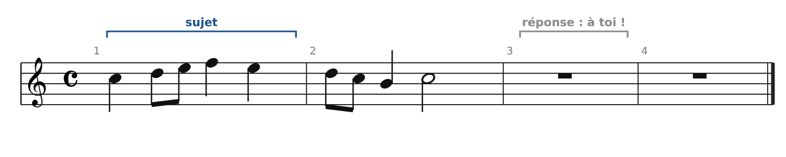
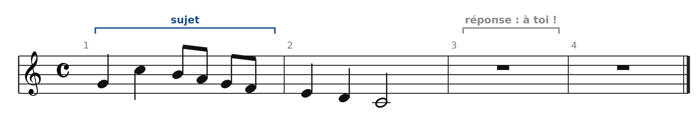
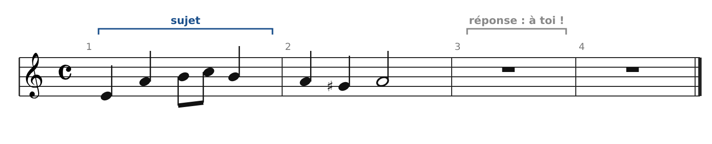
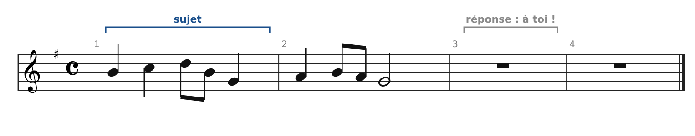
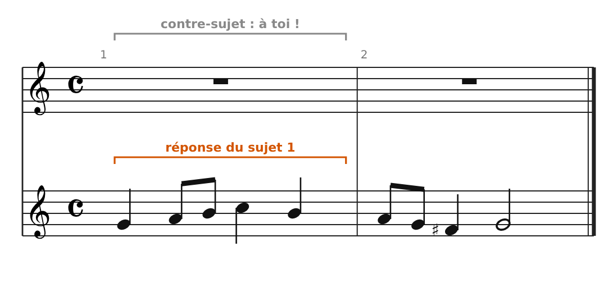
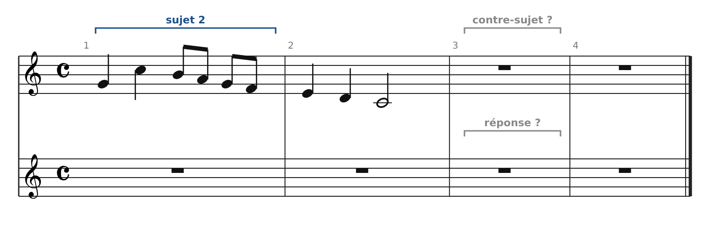
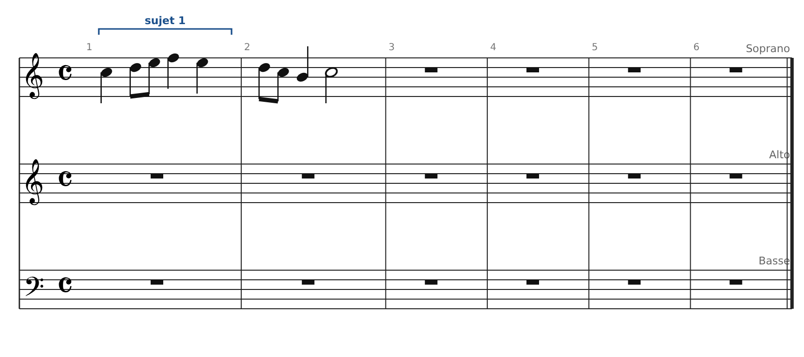

[← 16. Fugue à quatre voix : la Fugue en Do majeur (Clavier bien tempéré I, n°1, BWV 846)](19-fugue-a-quatre-voix-la-fugue-en-do-majeur-clavie.md) · [Sommaire](../README.md#sommaire) · [18. Corrigés de l'atelier →](21-corriges-de-l-atelier.md)

## 17. Atelier : écrire le début d'une fugue

Après l'analyse, place à l'écriture. On avance pas à pas : trouver la réponse, écrire un contre-sujet, puis assembler une exposition à deux, puis à trois voix. Tous les sujets sont originaux et écrits pour cet atelier.

### Méthode : les trois règles à connaître

**1. Réponse réelle ou tonale ?** La réponse reprend le sujet à la quinte supérieure (ou à la quarte inférieure), dans le ton de la dominante.

- Si le sujet **commence par la dominante**, ou fait tout de suite un saut **tonique ↔ dominante**, la réponse est **tonale** : dans la tête du sujet, on échange tonique et dominante (Sol répond Do, Do répond Sol). Le reste est transposé normalement.

- Sinon, la réponse est **réelle** : transposition exacte, avec la sensible du nouveau ton (Fa♯ en Sol majeur, Ré♯ en mi mineur…).

**2. Un bon contre-sujet**

- Il **contraste** avec le sujet : quand l'un bouge en croches, l'autre tient des noires, et inversement.

- Sur les temps, il forme surtout des **3ces et des 6tes** avec la réponse : il reste ainsi **renversable** (une 3ce devient une 6te et inversement ; une 5te deviendrait une 4te).

- Il respecte les règles des espèces : pas de 5tes ni d'8ves parallèles, dissonances seulement en passage.

**3. L'exposition**

- Voix 1 : sujet seul. Voix 2 : réponse, pendant que la voix 1 joue le contre-sujet. Voix 3 : sujet, pendant que la voix 2 joue le contre-sujet et que la voix 1 continue librement.

- Si la réponse ne ramène pas naturellement le ton principal, on ajoute une courte **codetta** avant l'entrée suivante.

### Exercice 1 : trouver la réponse

Pour chaque sujet : réponse réelle ou tonale ? Écris-la (mesures 3-4).

**Sujet 1** (Do majeur)

**Sujet 2** (Do majeur)

**Sujet 3** (la mineur)

**Sujet 4** (Sol majeur)

### Exercice 2 : écrire un contre-sujet

Voici la réponse du sujet 1. Écris au-dessus un contre-sujet de deux mesures. Vise des 3ces et des 6tes sur les temps, et un rythme qui complète celui de la réponse.

### Exercice 3 : exposition à deux voix

À partir du sujet 2, écris une exposition complète à deux voix : la réponse à la voix inférieure (mesures 3-4), et un contre-sujet à la voix supérieure.

### Exercice 4 : exposition à trois voix

À partir du sujet 1 et du contre-sujet de l'exercice 2, écris une exposition à trois voix : sujet au soprano (mesures 1-2), réponse à l'alto (3-4), sujet à la basse (5-6). À la mesure 5, l'alto reprend le contre-sujet transposé en Do majeur, et le soprano écrit un contrepoint libre.

### Exercice 5 (défi) : ta propre fugue à deux voix

Invente un sujet de deux mesures et écris une petite fugue à deux voix d'environ 12 mesures :

1.  **Mesures 1-4** : exposition (sujet, puis réponse avec contre-sujet).

2.  **Mesures 5-6** : divertissement en marche, construit avec la tête du sujet.

3.  **Mesures 7-8** : sujet dans un ton voisin (le relatif, ou la dominante).

4.  **Mesures 9-10** : second divertissement, qui ramène le ton principal.

5.  **Mesures 11-12** : dernière entrée du sujet et cadence parfaite.

---

[← 16. Fugue à quatre voix : la Fugue en Do majeur (Clavier bien tempéré I, n°1, BWV 846)](19-fugue-a-quatre-voix-la-fugue-en-do-majeur-clavie.md) · [Sommaire](../README.md#sommaire) · [18. Corrigés de l'atelier →](21-corriges-de-l-atelier.md)
