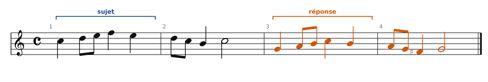
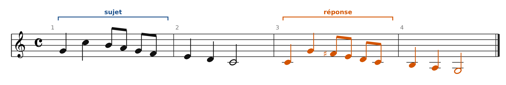
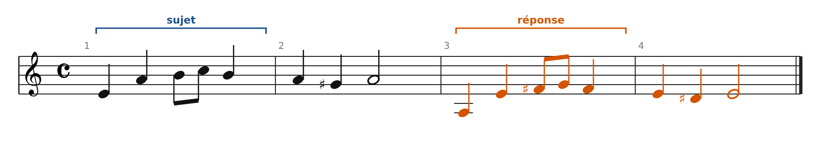
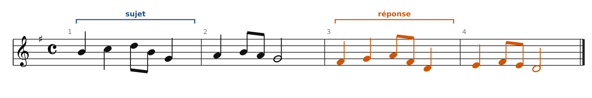
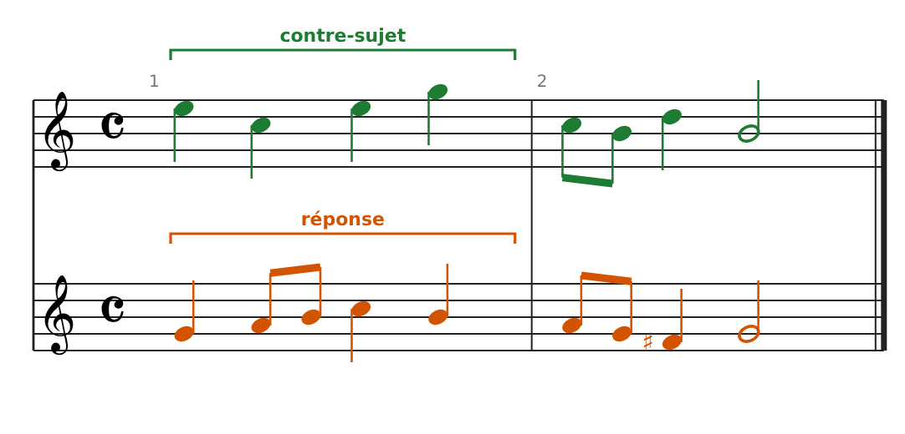
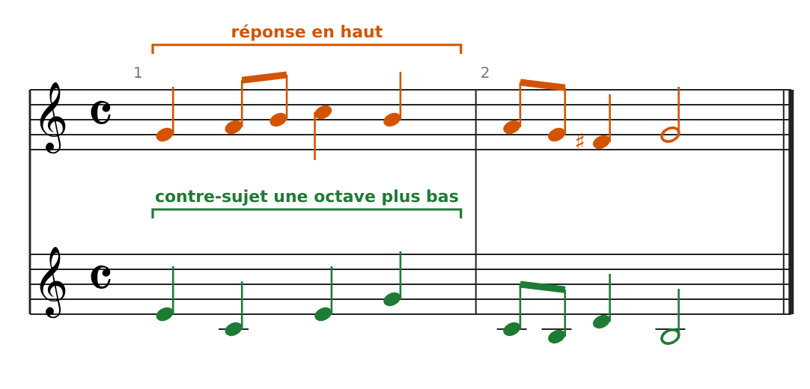
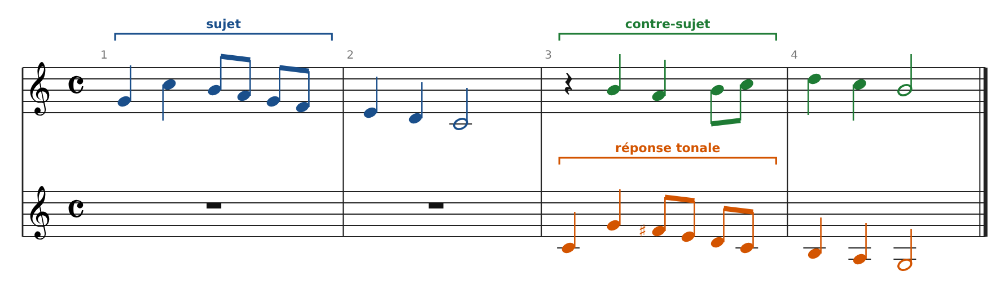
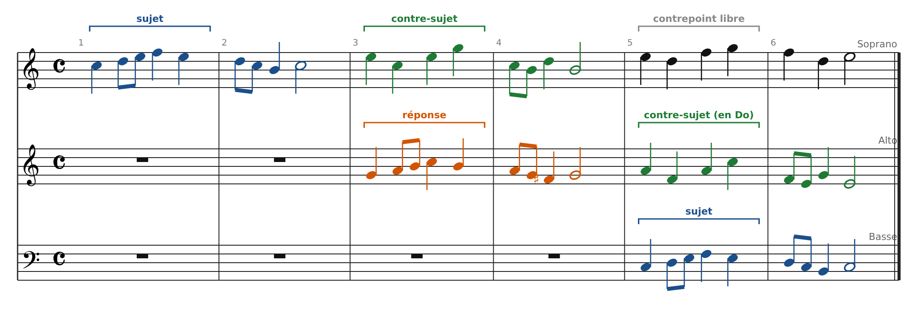

[← 17. Atelier : écrire le début d'une fugue](20-atelier-ecrire-le-debut-d-une-fugue.md) · [Sommaire](../README.md#sommaire)

## 18. Corrigés de l'atelier

Les solutions ci-dessous ont été vérifiées voix par voix : consonances sur les temps, dissonances seulement en passage, aucune 5te ni 8ve parallèle. Pour les exercices 2 à 4, d'autres solutions sont possibles.

### Exercice 1

**Sujet 1 : réponse réelle.** Le sujet commence sur la tonique et monte par degrés, sans saut Do-Sol. On transpose exactement en Sol majeur, avec Fa♯.

**Sujet 2 : réponse tonale.** Le sujet commence sur la dominante (Sol) et saute sur la tonique (Do). Dans la réponse, Sol est remplacé par Do, et Do par Sol : **Do-Sol** (quinte montante) répond à **Sol-Do** (quarte montante). La suite est transposée normalement : Fa♯ Mi Ré Do \| Si La Sol.

**Sujet 3 : réponse tonale.** Même cas en mineur : le sujet commence par Mi-La (dominante → tonique). La réponse fait **La-Mi** (quinte montante), puis continue en mi mineur : Fa♯ Sol Fa♯ \| Mi Ré♯ Mi. Le Ré♯ est la sensible de mi mineur, comme le Sol♯ l'était en la mineur.

**Sujet 4 : réponse réelle.** Le sujet commence sur la médiante (Si), sans saut tonique-dominante au début. Transposition exacte en Ré majeur : Fa♯ Sol La Fa♯ Ré Mi \| Fa♯ Mi Ré.

### Exercice 2

Contre-sujet : Mi Do Mi Sol \| Do-Si Ré Si. Sur chaque temps, l'intervalle avec la réponse est une 3ce ou une 6te : 6 - 3 - 3 - 6 \| 3 - 6 - 3. Le rythme reste calme : au temps 2 de la mesure 1, le contre-sujet tient une noire pendant que la réponse bouge en croches.

**Vérification du renversement** : placé une octave plus bas, sous la réponse, le contre-sujet donne 3 - 6 - 6 - 3 \| 6 - 3 - 6. Il n'y a toujours aucune dissonance sur les temps : le contre-sujet est bien renversable.

### Exercice 3

- **Réponse tonale** à la voix inférieure : Do Sol Fa♯ Mi Ré Do \| Si La Sol (voir exercice 1).

- **Contre-sujet** : un soupir pour laisser respirer la voix supérieure, puis Si La Si-Do \| Ré Do Si. Intervalles sur les temps : 3 - 3 - 6 \| 3 - 3 - 3 (10es entre les deux voix à la mesure 4).

- Le soupir au début du contre-sujet rend l'entrée de la réponse bien audible : c'est un procédé très fréquent chez Bach.

### Exercice 4

- **Mesures 1-4** : comme dans les exercices 1 et 2 (sujet au soprano, puis réponse à l'alto sous le contre-sujet).

- **Mesures 5-6, alto** : le contre-sujet, transposé une quinte plus bas pour revenir en Do majeur : La Fa La Do \| Fa-Mi Sol Mi.

- **Mesures 5-6, soprano** : contrepoint libre en noires, Mi Ré Fa Sol \| Fa Ré Mi. Il évite les 5tes et 8ves parallèles avec les deux autres voix et finit sur la tierce de l'accord de Do.

- La réponse se termine sur Sol (dominante) : l'entrée de la basse en Do peut suivre directement, sans codetta.

### Exercice 5 : grille d'auto-correction

- Le sujet est court, reconnaissable (un rythme ou un intervalle caractéristique) et finit sur la tonique ou la dominante.

- La réponse est correcte (réelle ou tonale selon la tête du sujet).

- Le contre-sujet contraste en rythme et forme des 3ces et des 6tes sur les temps.

- Les divertissements utilisent un fragment du sujet en marche.

- L'entrée centrale est dans un ton voisin, préparée par le divertissement.

- La fin revient au ton principal avec une cadence parfaite.

- Aucune 5te ni 8ve parallèle, et toutes les dissonances sont traitées (passage, broderie, retard).

---

[← 17. Atelier : écrire le début d'une fugue](20-atelier-ecrire-le-debut-d-une-fugue.md) · [Sommaire](../README.md#sommaire)
